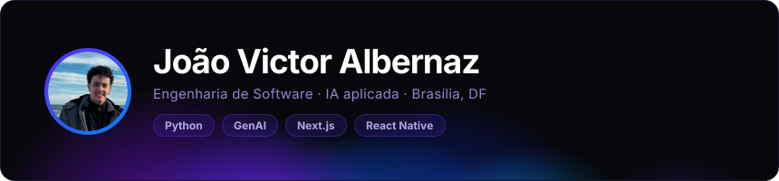

<!-- Perfil de João Victor Albernaz. Fonte para readme-aura: edite este arquivo, não o README.md gerado. -->

<strong>Engenharia de Software · UCB · Brasília, DF</strong>

Desenvolvo **produtos de software com IA aplicada**, conectando **LLMs, automações, APIs, bancos de dados e testes**. Trabalho do protótipo à arquitetura e busco evidências reproduzíveis para avaliar cada entrega.

### Em destaque · GenAI e engenharia de software

Três estudos de caso de produtos e um projeto de engenharia de ML. O código e os estágios de desenvolvimento estão identificados sem apresentar protótipos como produtos finalizados.

#### 01 — UniMove · Aplicativo, API e painel administrativo

**Problema:** facilitar a oferta e a busca de caronas para a comunidade universitária, com fluxos distintos de estudantes e administradores.\
**Implementação:** app em **React Native/Expo**, API **NestJS**, **PostgreSQL/Prisma**, autenticação, reservas, mensagens e painel web.\
**Evidência:** aplicativo, API e painel no mesmo repositório, com workflows de qualidade e autenticação administrativa independente com 2FA.\
**Explorar:** [Código e arquitetura](https://github.com/JoaoAlbernaz1/UniMove) · [Backend](https://github.com/JoaoAlbernaz1/UniMove/tree/main/UniMove-back) · [Protótipo de interface](https://shaky-awake-15985175.figma.site)

#### 02 — Finanças Bot · IA para linguagem natural e WhatsApp

**Problema:** registrar despesas sem exigir formulários, interpretando mensagens como “gastei 50 no mercado”.\
**Implementação:** extração estruturada por **LLM**, validação dos dados, regras de categorização em **TypeScript**, persistência em **PostgreSQL** e webhook da API oficial do **WhatsApp**.\
**Evidência:** testes no código para assinatura de mensagens, idempotência e falhas; suíte de 11 casos de aceitação com modelo real documentada, cuja execução depende de credenciais.\
**Acesso:** repositório privado; funcionalidades futuras como áudio e resumos agendados ainda não estão implementadas.

#### 03 — Selena · Assistente legislativo com IA

**Problema:** apoiar consultas e rotinas de atendimento legislativo por meio de interação conversacional.\
**Implementação:** fluxos de **n8n**, uso de **LLMs** e integração de APIs para automação e respostas orientadas ao contexto.\
**Evidência:** projeto privado de automação e IA aplicada. Código, métricas de uso e demonstração pública não estão disponíveis nesta página.

#### 04 — [ModelOps · Inferência, testes e robustez](./ml-lab/model-ops/)

**Problema:** transformar um modelo treinado em um serviço testável e acompanhar possíveis mudanças nos dados.\
**Implementação:** **FastAPI**, Docker, endpoints de inferência e health check, testes automatizados e métricas de drift.\
**Resultado medido:** no experimento com erros de digitação simulados, o macro-F1 do classificador caiu de **0,8964 para 0,8502**, demonstrando uma limitação verificável.\
**Explorar:** [API e testes](./ml-lab/model-ops/) · [Relatório de robustez](./ml-lab/published/model-ops/ROBUSTNESS.md) · [Decisões de arquitetura](./ml-lab/docs/modelops-architecture-decisions.md)

### Tecnologias

### Mais produtos e sistemas

Os projetos abaixo continuam no portfólio. Os botões Aura levam ao código público disponível.

**05 — [SeuConvite IA](https://github.com/JoaoAlbernaz1/seuconviteia)** · SaaS para convites digitais, sites de eventos e gestão multi-tenant. **Next.js, TypeScript, Prisma/PostgreSQL, autenticação e testes**. *Em desenvolvimento.* [Prévia hospedada](https://seuconviteia.vercel.app)

**06 — [PartWatch](https://github.com/JoaoAlbernaz1/ddr5-radar)** · Aplicativo para acompanhar peças de PC, preços registrados, wishlist e builds, com **Flutter/Dart** e **Supabase**. *Em desenvolvimento; comparação automática entre lojas ainda não está integrada.*

**07 — [Dashboard Ônibus DF](https://github.com/JoaoAlbernaz1/dashboard-onibus-df)** · App **React Native/Expo e TypeScript**, com navegação entre telas e indicadores. *Projeto acadêmico com dados fictícios.*

**08 — Curva S · Gestão de projetos** · Painel privado em **TypeScript** para leitura de cronogramas do MS Project, evolução planejada × realizada e análise de consistência.

**Sistema complementar — UniMove Admin** · Módulo de gestão integrado ao UniMove, com autenticação administrativa independente, gestão de usuários e revisão acadêmica. [Código público no repositório UniMove](https://github.com/JoaoAlbernaz1/UniMove/tree/main/UniMove-admin).

### Pesquisa e avaliação de Machine Learning

**[BANKING77-PTBR · classificação de intenções](./ml-lab/banking77-ptbr/)** — Experimento com **77 intenções em português** e comparação de modelos; **macro-F1 de 0,8964** no teste oficial e **0,8910** após excluir textos idênticos ao treino. [Modelo publicado](https://huggingface.co/JOAOOALBERNAZ/banking77-ptbr-intent-v1).

**[Confidence Evaluation · calibração e abstenção](./ml-lab/confidence-evaluation/)** — Separação entre treino, calibração e teste; **ECE de 0,7844 para 0,0134**, com **91,92% de acerto** nas previsões aceitas e **94,42% de cobertura** no teste. *Política experimental, não validada para produção.* [Artigo técnico](./ml-lab/docs/confidence-and-selective-prediction.md).

**[AI Evaluation Lab · avaliação de assistentes](./ml-lab/ai-evaluation-lab/)** — **32 casos de regressão** sobre recuperação de contexto, abstenção, ausência de evidência e ataques simulados. *Baseline extrativa com corpus fictício; os resultados não avaliam o desempenho de um LLM real.* [Resultados](./ml-lab/published/ai-eval/).

### Publicações e pesquisa

**Hugging Face** · [Modelos publicados](https://huggingface.co/JOAOOALBERNAZ) · [Dashboard de pesquisa](https://huggingface.co/spaces/JOAOOALBERNAZ/banking77-ptbr-research)\
**Kaggle** · [Meu perfil](https://www.kaggle.com/joaoalbernaz) · [Titanic: submissão #58521092](https://github.com/JoaoAlbernaz1/JoaoAlbernaz1/actions/runs/44368002721) · [Pesquisa de atributos: 84,17% em CV](./ml-lab/published/kaggle-titanic-advanced/) *(nota local, não leaderboard)*\
**Artigos** · [Calibração e risco](./ml-lab/docs/confidence-and-selective-prediction.md) · [Avaliação de RAG](./ml-lab/docs/experimental-note-nlp-rag-2026.md)

**Stack:** Python · scikit-learn · FastAPI · Docker · TypeScript · Next.js · React Native · PostgreSQL · n8n · APIs de LLM.

[Todos os experimentos e métricas](./ml-lab/) · [Contato](mailto:joaovictoralbernaz@gmail.com)
