 

SOFTWARE ENGINEERING  /  GENERATIVE AI  /  AUTOMATION

### João Victor Albernaz

**Engenharia de Software · IA aplicada · Produtos digitais**

Desenvolvo aplicações, APIs e automações que conectam **engenharia de software, agentes de IA e experiências reais de produto**.

Brasília, Brasil &nbsp; • &nbsp; Engenharia de Software — UCB

  

[**LINKEDIN**](https://www.linkedin.com/in/joaooalbernaz/) &nbsp; ✦ &nbsp; [**E-MAIL**](mailto:joaovictoralbernaz@gmail.com) &nbsp; ✦ &nbsp; [**REPOSITÓRIOS**](https://github.com/JoaoAlbernaz1?tab=repositories)

---

### 01 / ABOUT THE ENGINEER

Construo soluções de ponta a ponta: **frontend, backend, banco de dados, integrações e automação com IA**. Meu foco é desenvolver produtos úteis, bem estruturados e capazes de evoluir — do primeiro protótipo à operação.

Atualmente concentro meus estudos e projetos na interseção entre **GenAI, agentes inteligentes, sistemas distribuídos e desenvolvimento full-stack**. Gosto de combinar arquitetura, qualidade de código e experiências intuitivas.

  

### 02 / LANGUAGES & STACK

  

**Em uso:** TypeScript · JavaScript · Python · Java · C &nbsp; | &nbsp; **Em exploração:** Go · Kotlin

  

**Frontend & mobile** — React, Next.js, React Native, Expo, TypeScript.  
**Backend & dados** — Node.js, NestJS, Python, APIs REST, PostgreSQL, Prisma, Supabase e Redis.  
**IA & automação** — n8n, Make, OpenAI API, Claude / Anthropic API, engenharia de prompts, saídas estruturadas, webhooks e integrações.  
**DevOps & qualidade** — Docker, Git, testes automatizados com Vitest, Jest e Pytest.

### 03 / SELECTED PROJECTS

PROJETOS REAIS · DESENVOLVIMENTO APLICADO · GENAI

#### 01 — Selena / Assistente legislativa

`n8n` · `GenAI` · `WhatsApp` · `Webhooks` · **Privado**

Assistente legislativa para uso interno, com fluxos de automação e integração de IA a sistemas e processos. Trabalho na estruturação de automações, orquestração das rotinas e evolução das integrações.

**Engineering focus:** agentes, workflows, integração de LLMs e confiabilidade operacional.

---

#### 02 — [SeuConvite IA / SaaS para eventos](https://github.com/JoaoAlbernaz1/seuconviteia)

`Next.js` · `TypeScript` · `Prisma` · `React` · `OpenAI API` · **Público**

Plataforma SaaS para criar e gerenciar sites de eventos, com arquitetura multi-tenant, subdomínios, painel administrativo e autenticação. Inclui recursos opcionais de geração de imagens com IA. Produto em evolução.

**Engineering focus:** arquitetura SaaS, full-stack, IA integrada ao produto e experiência do usuário.

---

#### 03 — [UniMove / Aplicativo e API](https://github.com/JoaoAlbernaz1/UniMove)

`React Native` · `Expo` · `TypeScript` · `NestJS` · `PostgreSQL` · **Público**

Plataforma acadêmica de caronas com aplicativo, API REST, autenticação, gestão de usuários e veículos e solicitações de viagens. Inclui desenvolvimento colaborativo e trabalho relacionado ao painel administrativo.

**Engineering focus:** arquitetura mobile + API, dados, segurança e colaboração.

---

#### 04 — Curva S / Inteligência para acompanhamento de projetos

`React` · `TypeScript` · `Vitest` · **Privado**

Painel gerencial para acompanhar o avanço físico de projetos, com importação de cronogramas, cálculos de planejado x realizado e visualizações de progresso. O código e os dados da empresa permanecem privados.

**Engineering focus:** regras de negócio, análise de dados, visualizações e testes.

---

<b>+ OTHER WORK / MAIS PROJETOS</b>

 

**Finanças Bot** — Assistente privado com TypeScript, Claude API, Zod, PostgreSQL e WhatsApp Cloud API. Interpreta mensagens em linguagem natural, estrutura lançamentos financeiros e valida os resultados do modelo.

**Outros repositórios públicos** — [PartWatch](https://github.com/JoaoAlbernaz1/ddr5-radar) · [Dashboard de Transporte DF](https://github.com/JoaoAlbernaz1/dashboard-onibus-df) · [Pokédex RN](https://github.com/JoaoAlbernaz1/pokedex-rn)

### 04 / ACTIVITY & CONTRIBUTIONS

ATIVIDADE PÚBLICA NO GITHUB · GRÁFICO DINÂMICO

Se o gráfico estiver temporariamente indisponível, [veja as contribuições diretamente no GitHub](https://github.com/JoaoAlbernaz1?tab=overview).

### 05 / EXPERIENCE

**Desenvolvimento de IA e Automações** — *Projeto Selena · 2025–atual*  
Orquestração de fluxos no n8n, integração de APIs e aplicação de inteligência artificial à automação de processos.

**Desenvolvimento Web** — *Blue Ocean · 2025*  
Desenvolvimento de interfaces, sites e automações com Make/n8n, integrações de plataformas e APIs.

### 06 / NEXT CHAPTER

Quero continuar evoluindo em **GenAI, agentes de IA, sistemas escaláveis e engenharia de software**, transformando ideias em produtos consistentes e úteis.

INTERESSE EM OPORTUNIDADES DE ENGENHARIA DE SOFTWARE E INTELIGÊNCIA ARTIFICIAL GENERATIVA.

