<!-- README de portfólio; gerado por readme-aura. Edite readme.source.md. Estilo monocromático e animações SVG com readme-aura. -->

<strong>Engenharia de Software · UCB · Brasília, DF</strong>

<a href="https://www.linkedin.com/in/joaooalbernaz/">LinkedIn</a> &nbsp;·&nbsp; <a href="https://huggingface.co/JOAOOALBERNAZ">Hugging Face</a> &nbsp;·&nbsp; <a href="mailto:joaovictoralbernaz@gmail.com">E-mail</a>

Desenvolvo soluções de **Machine Learning e IA aplicada**, do treinamento e avaliação de modelos à construção de APIs, automações e sistemas. Meu foco é transformar experimentos em software reproduzível, testável e útil.

### Projetos selecionados

**01 — [BANKING77-PTBR · treinamento e avaliação](./ml-lab/banking77-ptbr/)**  
Classificador de **77 intenções em português**, com comparação de três modelos e avaliação em dados públicos. **Macro-F1 0,8964** no teste oficial; **0,8910** após excluir textos idênticos ao treino.  
[Código](./ml-lab/banking77-ptbr/) · [Modelo no Hugging Face](https://huggingface.co/JOAOOALBERNAZ/banking77-ptbr-intent-v1) · [Resultados e limitações](./ml-lab/docs/banking77-ptbr-results.md)

**02 — [Confidence Evaluation · calibração e abstenção](./ml-lab/confidence-evaluation/)**  
Novo modelo treinado com separação entre treino, calibração e teste. **ECE 0,7844 → 0,0134**; **91,92% de acertos** nas previsões aceitas, com **94,42% de cobertura** no teste. Política experimental, não validada para produção.  
[Código](./ml-lab/confidence-evaluation/) · [Modelo publicado](https://huggingface.co/JOAOOALBERNAZ/banking77-ptbr-confidence-v1) · [Artigo técnico](./ml-lab/docs/confidence-and-selective-prediction.md)

**03 — [ModelOps · inferência e monitoramento](./ml-lab/model-ops/)**  
API em **FastAPI**, Docker, testes automatizados e análise de mudança de distribuição. Um teste de erros de digitação simulados reduziu o macro-F1 de **0,8964 para 0,8502**, revelando uma limitação do classificador.  
[Código e testes](./ml-lab/model-ops/) · [Relatório de robustez](./ml-lab/published/model-ops/ROBUSTNESS.md) · [Arquitetura](./ml-lab/docs/modelops-architecture-decisions.md)

**04 — [AI Evaluation Lab · avaliação de assistentes](./ml-lab/ai-evaluation-lab/)**  
**32 casos de regressão** sobre recuperação de contexto, respostas sem evidência, abstenção e ataques simulados. Baseline extrativa com corpus fictício; os testes não representam desempenho de um LLM real.  
[Código e casos](./ml-lab/ai-evaluation-lab/) · [Resultados medidos](./ml-lab/published/ai-eval/)

### Publicações e participações

**Hugging Face** · [Modelos publicados](https://huggingface.co/JOAOOALBERNAZ) · [Dashboard interativo de pesquisa](https://huggingface.co/spaces/JOAOOALBERNAZ/banking77-ptbr-research)

**Kaggle** · [Titanic — Machine Learning from Disaster](https://www.kaggle.com/competitions/titanic) · [Submissão #58521092 confirmada](https://github.com/JoaoAlbernaz1/JoaoAlbernaz1/actions/runs/44368002721) · [Notebook e código](./ml-lab/kaggle-titanic/). **84,06% de accuracy na validação local** — não é a nota oficial do Kaggle.

**Pesquisa** · [Calibração e risco](./ml-lab/docs/confidence-and-selective-prediction.md) · [RAG: recuperar não é responder](./ml-lab/docs/experimental-note-nlp-rag-2026.md)

### Engenharia aplicada

- **Selena · assistente legislativa (projeto privado)** — fluxos de atendimento via WhatsApp com LLMs, n8n, APIs e acompanhamento de qualidade. Código e dados internos não são públicos.
- **[UniMove · plataforma de caronas universitárias](https://github.com/JoaoAlbernaz1/UniMove)** — aplicação e API com autenticação, controles administrativos, auditoria e testes.

**Tecnologias:** Python · scikit-learn · FastAPI · Docker · GitHub Actions · PostgreSQL · TypeScript · React · n8n · APIs de LLM.

Resultados apresentados com seus respectivos protocolos e limitações. [Explorar o ML & Research Lab](./ml-lab/) · [Contato](mailto:joaovictoralbernaz@gmail.com)
