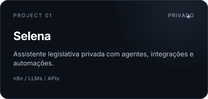
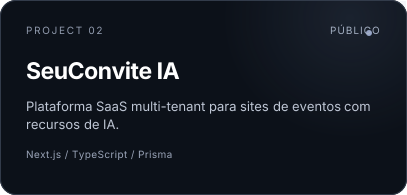
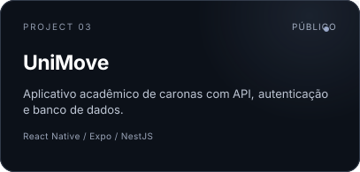
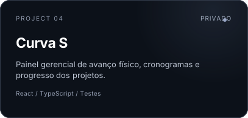

<!-- Gerado automaticamente com collectioneur/readme-aura. Edite este arquivo, não README.md. -->

<!-- Design: inspiração no layout DarkOrbs do readme-aura, adaptado para João Albernaz. -->

Em uso: Python, TypeScript, JavaScript, Java e C. Go e Kotlin são interesses para exploração.

### Projetos em destaque

<!-- project row 2 -->

<b>Ver detalhes e outros projetos</b>

**Selena:** Assistente legislativa privada com IA, n8n e integrações, incluindo fluxos internos não publicados.

**[SeuConvite IA](https://github.com/JoaoAlbernaz1/seuconviteia):** SaaS multi-tenant para eventos, autenticação e recursos opcionais de IA.

**[UniMove](https://github.com/JoaoAlbernaz1/UniMove):** Aplicativo mobile e API para caronas acadêmicas.

**Curva S:** Sistema privado de acompanhamento de projetos e comparação entre avanço planejado e realizado.

**Finanças Bot:** Assistente financeiro privado desenvolvido com TypeScript, Claude API e integração com WhatsApp.

[PartWatch](https://github.com/JoaoAlbernaz1/ddr5-radar) · [Dashboard Transporte DF](https://github.com/JoaoAlbernaz1/dashboard-onibus-df) · [Pokédex RN](https://github.com/JoaoAlbernaz1/pokedex-rn)

### Atividade no GitHub

Gráfico externo de contribuições · [Ver atividade diretamente no GitHub](https://github.com/JoaoAlbernaz1?tab=overview)

***

**João Victor Albernaz** · Engenharia de Software — UCB, Brasília

GenAI · Full-stack · Automação · Software Engineering

Design desenvolvido com [readme-aura](https://github.com/collectioneur/readme-aura), inspirado no visual de [collectioneur](https://github.com/collectioneur).

