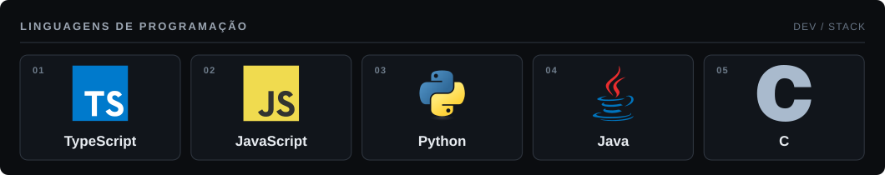

 

**Engenharia de Software · IA aplicada · Automações**

TypeScript · Sistemas completos · Integrações inteligentes

Brasília, Brasil · Universidade Católica de Brasília

  

[LinkedIn](https://www.linkedin.com/in/joaooalbernaz/) &nbsp; / &nbsp; [E-mail](mailto:joaovictoralbernaz@gmail.com) &nbsp; / &nbsp; [Projetos](https://github.com/JoaoAlbernaz1?tab=repositories)

---

### 01 / SOBRE MIM

Sou **João Victor Albernaz**, estudante de Engenharia de Software na Universidade Católica de Brasília (UCB). Desenvolvo aplicações, APIs e automações com foco em **IA generativa aplicada a problemas reais**.

Trabalho principalmente com **TypeScript e JavaScript**, utilizando React, Next.js, Node.js, NestJS, PostgreSQL e Supabase. Também desenvolvo fluxos com **n8n, Make, webhooks e integrações com modelos de linguagem**.

Meu interesse está na conexão entre engenharia de software, produtos digitais e **GenAI**: transformar ideias e processos em sistemas úteis, seguros e testáveis.

---

### 02 / LINGUAGENS + TECNOLOGIAS

  

    

  

**Desenvolvimento:** TypeScript, JavaScript, React, Next.js, Node.js, NestJS, React Native e Expo.

**IA e automações:** n8n, Make, Claude / Anthropic API, OpenAI API, engenharia de prompts, saídas estruturadas e webhooks.

**Dados e infraestrutura:** PostgreSQL, SQL, Prisma, Supabase, Docker, Redis e Git.

**Outras linguagens e ferramentas:** Python, Java, C, FastAPI e testes automatizados com Vitest/Jest/Pytest.

#### BEYOND THE STACK / FORA DO ÓBVIO

Uma coleção visual de linguagens que me despertam curiosidade — não uma declaração de experiência profissional.

---

### 03 / PROJETOS SELECIONADOS

#### Selena — Assistente legislativa

**n8n · IA generativa · WhatsApp · Automações · APIs** — *projeto privado*

Assistente legislativa de uso interno, construída com **n8n** para organizar fluxos de atendimento e integrar recursos de inteligência artificial a serviços e processos. Minha atuação envolve desenvolvimento e evolução das automações, webhooks e integrações com sistemas.

**Em destaque:** automação de processos, orquestração de fluxos, integração de LLMs e aplicação prática de IA.

*O projeto não possui repositório público e seus fluxos internos permanecem confidenciais.*

#### Finanças Bot — Linguagem natural para dados estruturados

**TypeScript · Claude API · Zod · PostgreSQL · WhatsApp Cloud API** — *repositório privado*

Assistente que interpreta mensagens em português, transforma texto em lançamentos financeiros categorizados e registra os resultados em banco de dados. Possui validação das saídas do modelo, tratamento de mensagens duplicadas, verificação de assinaturas de webhook e testes automatizados.

**Em destaque:** integração com LLMs, saídas estruturadas, confiabilidade e testes.

#### [SeuConvite IA — Plataforma SaaS](https://github.com/JoaoAlbernaz1/seuconviteia)

**Next.js · TypeScript · Prisma · React · OpenAI API** — *código público*

Plataforma SaaS para criação e gerenciamento de sites de eventos, com arquitetura multi-tenant, organização por subdomínios, painel administrativo e fluxos de autenticação. Inclui integração opcional para geração de imagens com IA e alternativas sem uso do modelo. Produto em evolução.

**Em destaque:** arquitetura SaaS, desenvolvimento full-stack, integrações de IA e experiência de produto.

#### [UniMove — Aplicativo e API](https://github.com/JoaoAlbernaz1/UniMove)

**React Native · Expo · TypeScript · NestJS · PostgreSQL · Prisma** — *código público*

Plataforma acadêmica de caronas com aplicativo mobile, API REST, autenticação, gerenciamento de usuários e veículos, solicitações de caronas e mensagens. O trabalho associado no painel administrativo contempla controle de acesso, interfaces de segurança e testes.

**Em destaque:** arquitetura ponta a ponta, backend, mobile e trabalho colaborativo.

#### Curva S — Acompanhamento de projetos

**React · TypeScript · Vitest · Análise de cronogramas** — *projeto privado*

Painel de acompanhamento de avanço físico de projetos, com importação de cronogramas, cálculos de planejado versus realizado, visualizações e testes automatizados. Os dados e o código associados à empresa são mantidos privados.

**Em destaque:** modelagem de regras de negócio, qualidade de dados e interfaces gerenciais.

Outros projetos públicos: [PartWatch](https://github.com/JoaoAlbernaz1/ddr5-radar) · [Dashboard de Transporte DF](https://github.com/JoaoAlbernaz1/dashboard-onibus-df) · [Pokédex RN](https://github.com/JoaoAlbernaz1/pokedex-rn)

---

### 04 / EXPERIÊNCIA

**Desenvolvimento de IA e Automações — Projeto Selena** · *2025–atual*  
Desenvolvimento e manutenção de fluxos de automação e integrações com IA para assistente legislativa privada, utilizando n8n e serviços conectados.

**Desenvolvimento Web — Blue Ocean** · *2025*  
Criação de interfaces web e automações com Make/n8n, integração de plataformas e APIs.

---

MENOS RUÍDO. MAIS ENGENHARIA.

Interesse em oportunidades de desenvolvimento de software e GenAI.

