<!-- Fonte do README gerado por readme-aura. Não edite README.md diretamente. -->

<!-- Arte original: estética black/chrome inspirada nas quatro referências fornecidas. -->

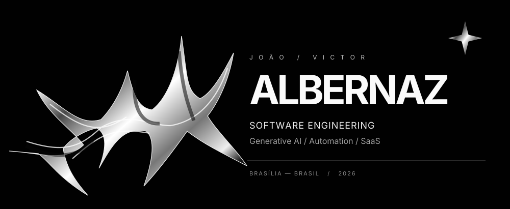

<b>Engenharia de Software · IA Aplicada · Automações</b> Universidade Católica de Brasília / Brasília, Brasil  <a href="https://www.linkedin.com/in/joaooalbernaz/">LINKEDIN</a> &nbsp; / &nbsp; <a href="mailto:joaovictoralbernaz@gmail.com">E-MAIL</a> &nbsp; / &nbsp; <a href="https://github.com/JoaoAlbernaz1?tab=repositories">REPOSITÓRIOS</a>

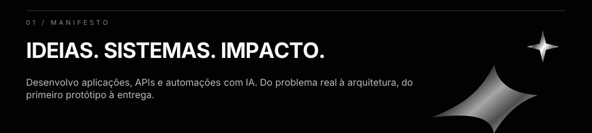

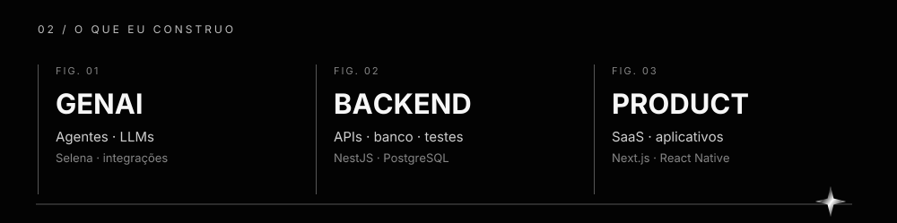

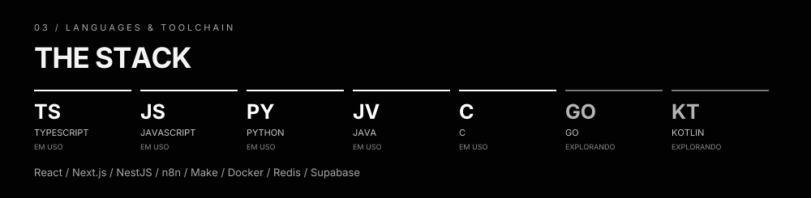

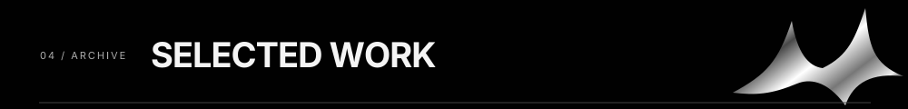

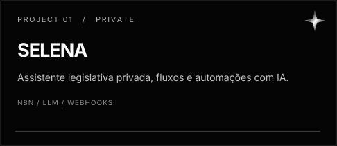<a href="https://github.com/JoaoAlbernaz1/seuconviteia">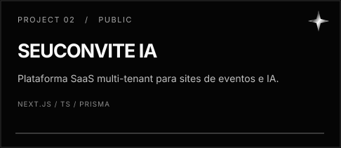</a>

<!-- separate project rows intentionally -->

<a href="https://github.com/JoaoAlbernaz1/UniMove">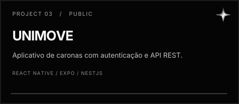</a>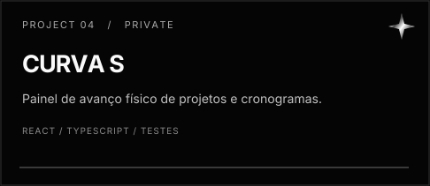

<b>+ PROJETOS / DETALHES TÉCNICOS</b>

**Selena** — Assistente legislativa privada construída com n8n, integração de LLMs e processos internos. Seus fluxos e repositórios não são públicos.

**[SeuConvite IA](https://github.com/JoaoAlbernaz1/seuconviteia)** — SaaS para gerenciamento de sites de eventos, multi-tenancy, subdomínios e integração opcional de recursos de IA.

**[UniMove](https://github.com/JoaoAlbernaz1/UniMove)** — Plataforma acadêmica mobile de caronas com API, autenticação, usuários e veículos.

**Curva S** — Sistema privado para acompanhamento físico de projetos, cronogramas e realizado versus planejado.

**Finanças Bot** — Assistente financeiro privado com TypeScript, Claude API, Zod, PostgreSQL e WhatsApp Cloud API.

Outros projetos: [PartWatch](https://github.com/JoaoAlbernaz1/ddr5-radar) · [Dashboard de Transporte DF](https://github.com/JoaoAlbernaz1/dashboard-onibus-df) · [Pokédex RN](https://github.com/JoaoAlbernaz1/pokedex-rn).

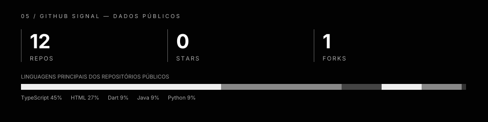

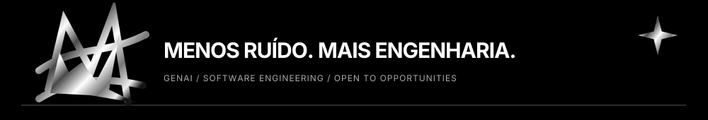

<b>Desenvolvimento de IA e Automações</b> — Selena (2025–atual) &nbsp; / &nbsp; <b>Desenvolvimento Web</b> — Blue Ocean (2025) 
Transformando ideias em sistemas úteis, testáveis e escaláveis. 
Design original renderizado com <a href="https://github.com/collectioneur/readme-aura">readme-aura</a>.

