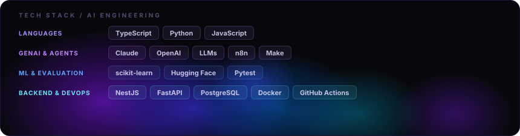

<!-- README de portfólio: estrutura em 3 painéis Aurora inspirada no perfil Collectioneur; gerado por readme-aura. Edite readme.source.md. -->

<strong>Engenharia de Software · UCB · Brasília, DF</strong>

Desenvolvo **Machine Learning e IA aplicada**, do treinamento de modelos a produtos com APIs, automações e testes. Gosto de transformar experimentos em software reproduzível, mensurável e útil.

### Projetos selecionados

**01 — [BANKING77-PTBR · treinamento e avaliação](./ml-lab/banking77-ptbr/)**\
Classificador de **77 intenções em português**, com comparação de três modelos e avaliação em dados públicos. **Macro-F1 0,8964** no teste oficial; **0,8910** após excluir textos idênticos ao treino.\
[Código](./ml-lab/banking77-ptbr/) · [Modelo no Hugging Face](https://huggingface.co/JOAOOALBERNAZ/banking77-ptbr-intent-v1) · [Resultados e limitações](./ml-lab/docs/banking77-ptbr-results.md)

**02 — [Confidence Evaluation · calibração e abstenção](./ml-lab/confidence-evaluation/)**\
Novo modelo treinado com separação entre treino, calibração e teste. **ECE 0,7844 → 0,0134**; **91,92% de acertos** nas previsões aceitas, com **94,42% de cobertura** no teste. Política experimental, não validada para produção.\
[Código](./ml-lab/confidence-evaluation/) · [Modelo publicado](https://huggingface.co/JOAOOALBERNAZ/banking77-ptbr-confidence-v1) · [Artigo técnico](./ml-lab/docs/confidence-and-selective-prediction.md)

**03 — [ModelOps · inferência e monitoramento](./ml-lab/model-ops/)**\
API em **FastAPI**, Docker, testes automatizados e análise de mudança de distribuição. Um teste de erros de digitação simulados reduziu o macro-F1 de **0,8964 para 0,8502**, revelando uma limitação do classificador.\
[Código e testes](./ml-lab/model-ops/) · [Relatório de robustez](./ml-lab/published/model-ops/ROBUSTNESS.md) · [Arquitetura](./ml-lab/docs/modelops-architecture-decisions.md)

**04 — [AI Evaluation Lab · avaliação de assistentes](./ml-lab/ai-evaluation-lab/)**\
**32 casos de regressão** sobre recuperação de contexto, respostas sem evidência, abstenção e ataques simulados. Baseline extrativa com corpus fictício; os testes não representam desempenho de um LLM real.\
[Código e casos](./ml-lab/ai-evaluation-lab/) · [Resultados medidos](./ml-lab/published/ai-eval/)

### Produtos e sistemas

Projetos de software com foco em IA aplicada, engenharia de produtos, APIs e automações. Repositórios privados permanecem identificados como privados.

**Em destaque · IA aplicada e automações**

**01 — Selena · Assistente legislativo** — Assistente privado de IA conversacional integrado a fluxos de automação e atendimento legislativo com LLMs, n8n e APIs.

**02 — Finanças Bot · IA financeira** — Sistema privado em TypeScript que usa modelos de linguagem para estruturar lançamentos financeiros em português, classificar registros no PostgreSQL e processar mensagens via webhook do WhatsApp.

**Engenharia de IA · código e avaliação reproduzível**

[**ModelOps · API de inferência, Docker e robustez**](./ml-lab/model-ops/) — Serviço com FastAPI, testes automatizados e avaliação de mudança de distribuição em entradas de texto.

[**AI Evaluation Lab · testes de agentes e assistentes**](./ml-lab/ai-evaluation-lab/) — 32 casos de regressão sobre recuperação de contexto, abstenção e resistência a instruções adversariais. *Baseline experimental com corpus fictício, não avaliação de um LLM real.*

**Produtos com código público**

**03 — SeuConvite IA** · SaaS de convites e sites para eventos, com Next.js, TypeScript, estrutura multi-tenant, autenticação e integrações. *Em desenvolvimento.*

**04 — UniMove** · App mobile e painel web com React Native, NestJS, PostgreSQL, API REST, autenticação e testes.

**05 — PartWatch** · Aplicativo de histórico de preços de peças de PC, wishlist, registro de alertas e builds. *Em desenvolvimento; comparador multi-loja ainda não integrado.*

**06 — Dashboard Ônibus DF** · Aplicativo React Native com painéis de indicadores e navegação. *Protótipo acadêmico com dados fictícios.*

**Outros sistemas**

**07 — Curva S · Gestão de projetos** — Painel privado em TypeScript para análise de cronogramas do MS Project, curvas de avanço físico e validação de dados.

**08 — UniMove Admin · Gestão e segurança** — Módulo administrativo do UniMove com autenticação independente, controle de usuários e fluxos de revisão.

Os oito produtos e sistemas foram mantidos. Os casos de engenharia de IA acima são trabalhos técnicos adicionais. Projetos privados não possuem links públicos; protótipos e sistemas em desenvolvimento não são apresentados como serviços prontos para produção.

### Publicações e pesquisa

**Hugging Face** · [Modelos publicados](https://huggingface.co/JOAOOALBERNAZ) · [Dashboard de pesquisa](https://huggingface.co/spaces/JOAOOALBERNAZ/banking77-ptbr-research)\
**Kaggle** · [Meu perfil](https://www.kaggle.com/joaoalbernaz) · [Titanic: submissão #58521092](https://github.com/JoaoAlbernaz1/JoaoAlbernaz1/actions/runs/44368002721) · [Pesquisa de atributos: 84,17% em CV](./ml-lab/published/kaggle-titanic-advanced/) *(nota local, não leaderboard)*\
**Artigos** · [Calibração e risco](./ml-lab/docs/confidence-and-selective-prediction.md) · [Avaliação de RAG](./ml-lab/docs/experimental-note-nlp-rag-2026.md)

**Stack:** Python · scikit-learn · FastAPI · Docker · TypeScript · Next.js · React Native · PostgreSQL · n8n · APIs de LLM.

[Todos os experimentos e métricas](./ml-lab/) · [Contato](mailto:joaovictoralbernaz@gmail.com)
