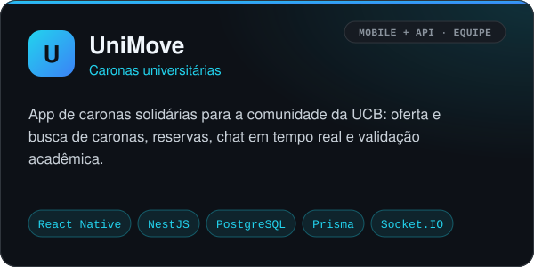
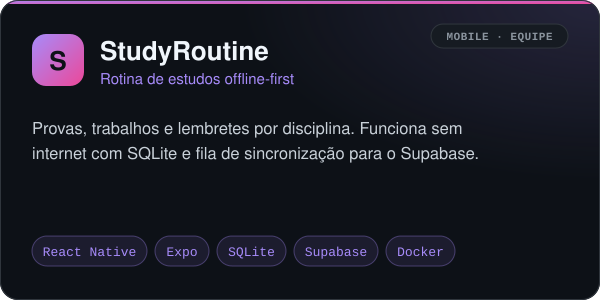
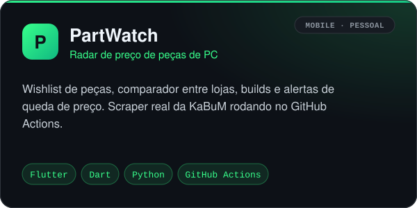
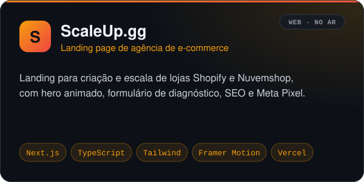
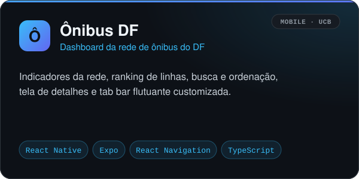
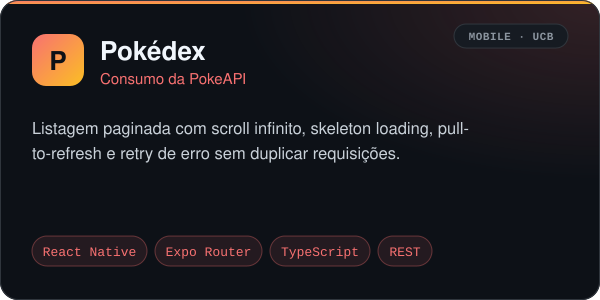

  

  
  
  
  

---

### 👋 Sobre mim

- 🎓 Estudante de **Engenharia de Software / IA** na Universidade Católica de Brasília (UCB)
- 🏛️ Estagiário no **Senado Federal** — banco de dados, levantamento de requisitos e sistemas em Oracle APEX
- 🚀 Crio produtos do zero: web, mobile e **automações com IA** (n8n + OpenAI) para pequenos negócios
- 📍 Brasília, DF 🇧🇷

### 🛠️ Stack

   
  

  
  
  
  
  

---

### ⭐ Projetos em destaque

  
  
  
  
  
  

ScaleUp.gg abre o site no ar · <a href="https://github.com/JoaoAlbernaz1/landing-page-scaleup">código-fonte</a>

### 🔨 Construindo agora

| Projeto | O que é | Stack |
| --- | --- | --- |
| **Zinc** 🔒 | Plataforma SaaS de checkout | Next.js · TypeScript · Supabase |
| **SeuConvite** 🔒 | SaaS de sites de convite digital | Next.js · Supabase · OpenAI |
| **Automações com IA** 🔒 | Atendimento no WhatsApp e fluxos para pequenos negócios | n8n · OpenAI · Supabase |

🔒 código privado — demonstração sob pedido.

---

### 📈 Atividade

  <picture>
    <source media="(prefers-color-scheme: dark)" srcset="https://raw.githubusercontent.com/JoaoAlbernaz1/JoaoAlbernaz1/output/snake-dark.svg" />
    <source media="(prefers-color-scheme: light)" srcset="https://raw.githubusercontent.com/JoaoAlbernaz1/JoaoAlbernaz1/output/snake.svg" />
    
  </picture>

