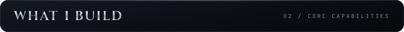
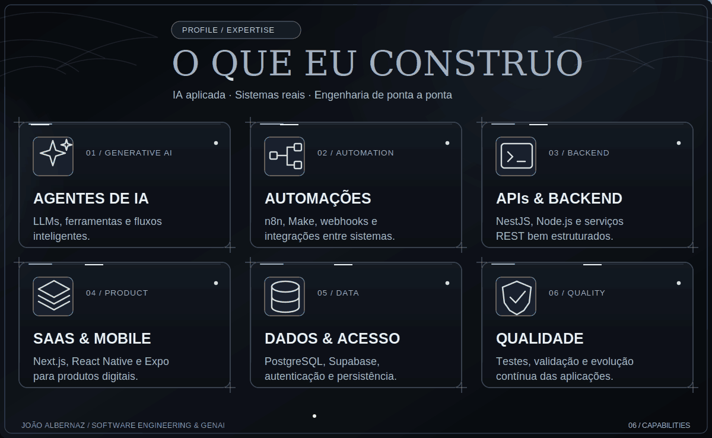
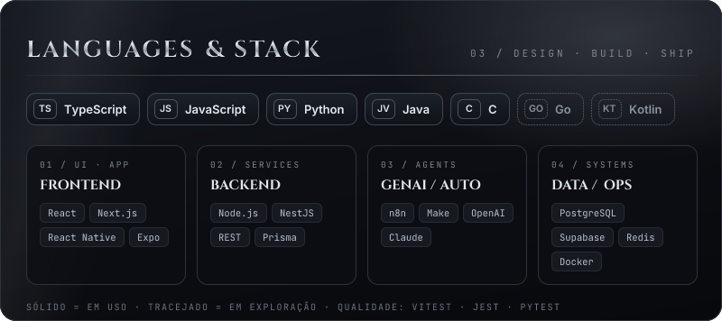
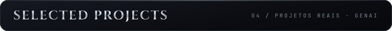
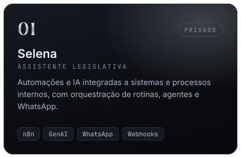
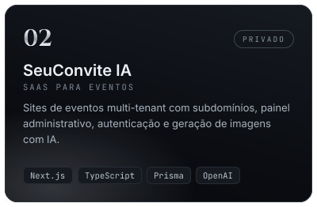
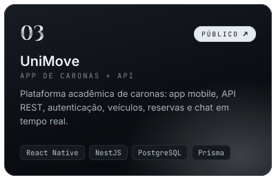
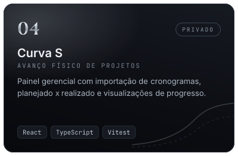

<!--
  FONTE DO README — edite este arquivo, não o README.md.
  Para gerar de novo (na raiz do repo):
    npx readme-aura@1.0.20 build --fonts-dir .github/fonts
    node .github/scripts/fix-nested-svg.mjs
  O segundo comando corrige um bug do readme-aura que esconde SVGs internos (ícones, órbita, cursor).
  Os blocks ```aura são JSX (Satori) convertidos em SVG animado em .github/assets.
-->

<div align="center">

</div>

<p align="center">
<a href="https://www.linkedin.com/in/joaooalbernaz/"></a><a href="mailto:joaovictoralbernaz@gmail.com"></a><a href="https://github.com/JoaoAlbernaz1?tab=repositories"></a>
</p>





<div align="center">



<sub>[Versão estática do painel](./assets/feature-grid-chrome.png)</sub>

<sub>Seis áreas que conectam meus estudos e projetos a problemas reais — com foco em engenharia aplicada.</sub>

</div>

<!-- Layout visual inspirado no Feature 08 do Hirael (MIT) por Mohammad Shehadeh: https://hirael.com/blocks/features/feature-08 -->





<p align="center">
<a href="https://github.com/JoaoAlbernaz1/UniMove"></a>
</p>

<details>
<summary><b>+ OTHER WORK / MAIS PROJETOS</b></summary>

<br/>

**Finanças Bot** — Assistente privado com TypeScript, Claude API, Zod, PostgreSQL e WhatsApp Cloud API. Interpreta mensagens em linguagem natural, estrutura lançamentos financeiros e valida os resultados do modelo.

**Outros repositórios públicos** — [PartWatch](https://github.com/JoaoAlbernaz1/ddr5-radar) · [Dashboard de Transporte DF](https://github.com/JoaoAlbernaz1/dashboard-onibus-df) · [Pokédex RN](https://github.com/JoaoAlbernaz1/pokedex-rn)

</details>



<div align="center">

<a href="https://github.com/JoaoAlbernaz1?tab=overview"></a>


</div>
