<!--
  Perfil de João Victor Albernaz.
  Design enxuto e profissional, editável diretamente neste arquivo.
  O antigo projeto visual cromado permanece em readme.source.md e .github/assets,
  guardado como material de estudo, mas não é usado por este README.
-->

 

  
  
  

**Engenharia de Software na UCB** · Brasília, Brasil · Foco em **Generative AI e desenvolvimento de software**

---

### 👨‍💻 Sobre mim

Sou estudante de **Engenharia de Software** e desenvolvedor com foco em **IA generativa, automações, aplicações full-stack e arquiteturas de software**.

- 🤖 Trabalho com **agentes de IA, LLMs, n8n, Make e integrações por API**.
- ⚙️ Desenvolvo **backends, aplicações web e mobile**, da modelagem à entrega.
- 🧩 Gosto de transformar processos complexos em produtos simples, testáveis e escaláveis.
- 🎯 Tenho interesse em oportunidades de **GenAI e engenharia de software**.

### 🛠️ Linguagens e tecnologias

**Linguagens**

Python, TypeScript, JavaScript, Java e C em uso · Go e Kotlin em exploração

  

**Frameworks, ferramentas e infraestrutura**

 

`n8n` · `Make` · `Expo` · `React Native` · `OpenAI API` · `Claude API` · `REST` · `Webhooks`

### 🚀 Projetos em destaque

<table>
  <tr>
    <td width="50%" valign="top">
      <h3><a href="https://github.com/JoaoAlbernaz1/seuconviteia">✨ SeuConvite IA</a></h3>
      
Plataforma SaaS para criar e gerenciar sites de eventos, com estrutura multi-tenant, autenticação, subdomínios e funcionalidades integradas com IA.

      
<code>Next.js</code> <code>TypeScript</code> <code>Prisma</code> <code>OpenAI API</code>

      Projeto público · Em evolução
    </td>
    <td width="50%" valign="top">
      <h3><a href="https://github.com/JoaoAlbernaz1/UniMove">🚗 UniMove</a></h3>
      
Aplicativo e API para caronas acadêmicas, com autenticação, gerenciamento de usuários, veículos e solicitações de viagem.

      
<code>React Native</code> <code>Expo</code> <code>NestJS</code> <code>PostgreSQL</code>

      Projeto público · Desenvolvimento colaborativo
    </td>
  </tr>
  <tr>
    <td width="50%" valign="top">
      <h3>🤖 Selena</h3>
      
Assistente legislativa privada com IA, integrações e orquestração de fluxos automatizados para processos internos.

      
<code>n8n</code> <code>LLMs</code> <code>Webhooks</code> <code>APIs</code>

      Projeto privado · Arquitetura e fluxos internos não publicados
    </td>
    <td width="50%" valign="top">
      <h3>📈 Curva S</h3>
      
Sistema de acompanhamento físico de projetos, com importação de cronogramas e visualização de progresso planejado versus realizado.

      
<code>React</code> <code>TypeScript</code> <code>Gráficos</code> <code>Testes</code>

      Projeto privado · Uso empresarial
    </td>
  </tr>
</table>

  
<b>Explorar outros trabalhos</b>

   
  
<b>Finanças Bot:</b> assistente financeiro privado desenvolvido com TypeScript, Claude API e integração WhatsApp.

  
<a href="https://github.com/JoaoAlbernaz1/ddr5-radar">PartWatch</a> · <a href="https://github.com/JoaoAlbernaz1/dashboard-onibus-df">Dashboard Transporte DF</a> · <a href="https://github.com/JoaoAlbernaz1/pokedex-rn">Pokédex React Native</a>

### 📊 Atividade no GitHub

Atividade pública gerada automaticamente · <a href="https://github.com/JoaoAlbernaz1?tab=overview">Ver contribuições diretamente no GitHub</a>

---

**Construindo software com propósito.**

Python · TypeScript · Agentes de IA · APIs · SaaS

  

<a href="https://github.com/JoaoAlbernaz1">Voltar ao topo do perfil</a>

