<!-- README de portfólio; gerado por readme-aura. Edite readme.source.md. Estilo monocromático e animações SVG com readme-aura. -->

<strong>Desenvolvedor de IA aplicada · Engenharia de Software (UCB) · Conclusão prevista: 2027</strong>

<a href="https://www.linkedin.com/in/joaooalbernaz/">LinkedIn</a> &nbsp;·&nbsp; <a href="mailto:joaovictoralbernaz@gmail.com">E-mail</a> &nbsp;·&nbsp; <a href="https://github.com/JoaoAlbernaz1?tab=repositories">Código público</a>

Construo soluções de **IA generativa aplicadas a processos reais**: assistentes conversacionais, fluxos com LLMs, automações, APIs e produtos digitais. Trabalho com **Claude, OpenAI, n8n, Make, TypeScript e Python**, conectando a IA a dados, testes e experiência de uso.

### ML & Research Lab · projetos com experimentação

**Machine Learning & pesquisa aplicada.** Modelos treinados, experimentos reproduzíveis e métricas documentadas.

| Experimento | Engenharia e avaliação |
| :--- | :--- |
| **[NLP · classificador de intenções](./ml-lab/nlp-intent-classifier/)** | Python, TF-IDF, Logistic Regression, macro-F1, validação cruzada; [modelo publicado no Hugging Face](https://huggingface.co/JOAOOALBERNAZ/intent-classifier-pt). |
| **[Retrieval / RAG Benchmark](./ml-lab/retrieval-benchmark/)** | Comparação BM25 × TF-IDF, Recall@k e MRR@k, embeddings multilíngues opcionais; testes reproduzíveis. |
| **[Kaggle Titanic · baseline](./ml-lab/kaggle-titanic/)** | Pipeline tabular, validação estratificada, notebook e gerador de CSV para submissão. |
| **[Artigo técnico · avaliação de ML](./ml-lab/docs/avaliacao-reprodutivel-de-ml.md)** | Discussão sobre leakage, métricas, experimentos e limites de avaliação. |

**Modelo publicado no Hugging Face:** [intent-classifier-pt](https://huggingface.co/JOAOOALBERNAZ/intent-classifier-pt) · **artefato local:** [artefato e cartão técnico](./ml-lab/published/intent-v1/) · [métricas medidas](./ml-lab/published/intent-v1/metrics.json) · [retrieval benchmark](./ml-lab/published/retrieval-v1/metrics.json). *Resultados sobre dados sintéticos, não validação em produção.*

Experimentos documentados com resultados verificáveis; conjuntos sintéticos utilizados onde indicado. [Explorar o ML & Research Lab](./ml-lab/).

### Experiência prática com IA

**Selena · SLCN / Senado Federal · 2025–atual — projeto privado.** Atuação no desenvolvimento e na manutenção de um assistente de atendimento via WhatsApp. Integrações com OpenAI, n8n, Supabase, APIs e webhooks; acompanhamento de métricas e feedback das interações para orientar melhorias. O código e os dados internos não são públicos.

**Finanças Bot · projeto pessoal privado.** Aplicação com Claude/Anthropic API que interpreta mensagens financeiras em português e cria registros estruturados no PostgreSQL. Inclui validação de saída, integração à WhatsApp Cloud API, verificação de assinatura, prevenção de duplicidade e testes determinísticos. Detalhamento técnico disponível em entrevista.

### Código e produtos que você pode explorar

**[UniMove — app e API de caronas universitárias](https://github.com/JoaoAlbernaz1/UniMove)**\
Aplicação colaborativa ponta a ponta com React Native/Expo, NestJS, PostgreSQL e Prisma. Desenvolvi e evoluí funcionalidades administrativas com **controle de acesso, autenticação multifator, auditoria e testes automatizados**.

**[SeuConvite IA — plataforma SaaS multi-tenant](https://github.com/JoaoAlbernaz1/seuconviteia)**\
Produto em desenvolvimento para criação de sites de eventos por subdomínio. Arquitetura com Next.js/TypeScript, isolamento multi-tenant planejado e desenvolvimento guiado por documentação e skills do Claude Code. **Ainda em evolução; não apresentado como produto concluído.**

**Curva S — acompanhamento de projetos · sistema privado**\
Painel em React e TypeScript para importação de cronogramas, comparação de avanço planejado versus realizado e visualização gerencial, com separação entre regras de cálculo e interface.

### Stack que uso na prática

| Área | Ferramentas e competências |
| :--- | :--- |
| **IA & agentes** | Claude / Anthropic API, OpenAI, LLMs, prompt engineering, saídas estruturadas, orquestração de fluxos |
| **Automações** | n8n, Make, webhooks, WhatsApp Cloud API, integrações REST |
| **Engenharia** | TypeScript, JavaScript, Python, Node.js, NestJS, FastAPI, React, Next.js, React Native / Expo |
| **Dados & qualidade** | PostgreSQL, Supabase, Prisma, Redis, Docker, GitHub Actions, Vitest, Jest, Pytest |

Brasília, DF · <a href="mailto:joaovictoralbernaz@gmail.com">joaovictoralbernaz@gmail.com</a> · <a href="https://www.linkedin.com/in/joaooalbernaz/">LinkedIn</a>

Componentes SVG renderizados com <a href="https://github.com/collectioneur/readme-aura">readme-aura</a> · inspiração visual em <a href="https://github.com/collectioneur">collectioneur</a>

