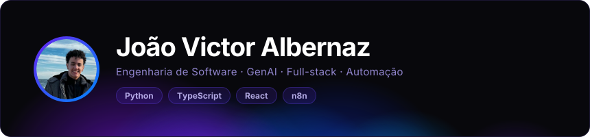
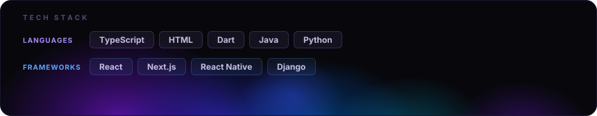

<!-- Visual inspirado no perfil collectioneur, produzido com readme-aura. Componentes e animacoes adaptados para Joao Albernaz. -->

Engenharia de Software · GenAI · Full-stack · Automação

<a href="https://github.com/JoaoAlbernaz1/UniMove">UniMove</a> · <a href="https://github.com/JoaoAlbernaz1/seuconviteia">SeuConvite IA</a> · Selena (projeto privado) · Curva S (projeto privado)

Design baseado em <a href="https://github.com/collectioneur">collectioneur</a> · Powered by <a href="https://github.com/collectioneur/readme-aura">readme-aura</a>

