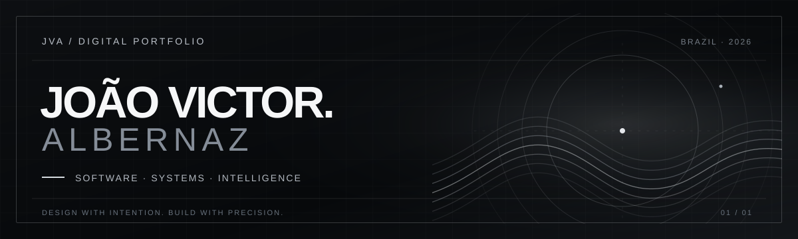

  
   
   
  <strong>AI & Automation Developer · Software Engineering Undergraduate</strong>
   
  TypeScript-first engineering. LLM integrations. End-to-end digital products.
   
  Brasília, Brazil · Universidade Católica de Brasília (UCB)
   
   
  <a href="https://www.linkedin.com/in/joaooalbernaz/">LINKEDIN</a> &nbsp;·&nbsp; <a href="mailto:joaovictoralbernaz@gmail.com">EMAIL</a> &nbsp;·&nbsp; <a href="https://github.com/JoaoAlbernaz1?tab=repositories">PUBLIC CODE</a>

---

### 01 / PROFILE

I’m **João Victor Albernaz**, a Software Engineering undergraduate focused on **generative AI, intelligent automations, APIs and full-stack development**.

My primary stack is **TypeScript / JavaScript**. I work with **React, Next.js, Node.js, NestJS, PostgreSQL and Supabase**, connecting products to LLMs, webhooks and real-world workflows. I also use Python and FastAPI when they fit a project's needs.

I’m especially interested in **AI Builder / applied GenAI** roles: transforming natural-language interactions into useful, testable software.

**What I value:** working systems, clear architecture, secure integrations and tests over flashy claims.

---

### 02 / FOCUS & TOOLKIT

  

- **Generative AI:** Claude / Anthropic API, OpenAI API, prompt design, JSON/structured outputs, schema validation and LLM-assisted workflows.
- **Automation:** n8n, Make, WhatsApp Cloud API, webhooks, integrations between business systems.
- **Engineering:** TypeScript, JavaScript, React, Next.js, Node.js, NestJS, PostgreSQL, Prisma, Supabase, Docker, Git and automated testing.
- **Also working with:** React Native / Expo, Python / FastAPI, Redis and background jobs.

---

### 03 / SELECTED WORK

> **The best examples of what I build.** Public repositories link directly to code. Private projects are described as technical case studies; no private code or client data is exposed here.

#### Finanças Bot — Natural language to structured data
**TypeScript · Claude / Anthropic API · Zod · PostgreSQL · WhatsApp Cloud API** `PRIVATE REPOSITORY`

A personal finance assistant that interprets messages such as *"gastei 50 no mercado"*, validates the LLM output against structured schemas and stores categorized transactions. The system uses a WhatsApp webhook with signature checks, duplicate-message handling, deterministic tests and separate real-model acceptance cases.

**Focus:** applied GenAI, reliable LLM outputs, API integration, data integrity and testability.

#### [UniMove — Mobile application & API](https://github.com/JoaoAlbernaz1/UniMove)
**React Native · Expo · TypeScript · NestJS · PostgreSQL · Prisma** `PUBLIC REPOSITORY`

Collaborative academic ridesharing platform with authentication, user and driver profiles, ride offers and requests, messaging and a REST API. My related administrative-panel work includes access control, security-focused UI and automated tests.

**Focus:** end-to-end architecture, backend systems, secure applications and teamwork.

#### SeuConvite IA — Multi-tenant SaaS
**Next.js · React · TypeScript · Prisma · OpenAI integration** `PRIVATE REPOSITORY`

An evolving SaaS for event websites, with tenant-aware routing, account and event workflows, and server-side image generation that can use OpenAI models or a local fallback. Features are at different stages of development.

**Focus:** product engineering, multi-tenancy, AI-assisted features, validation and testing.

#### Curva S — Project progress analytics
**React · TypeScript · Vitest · scheduling data** `PRIVATE CLIENT PROJECT`

A browser-based dashboard that imports project schedules, separates calculation logic from the interface and presents planned-versus-actual progress. The implementation includes tests and anonymized fixtures. Client information and source code remain private.

**Focus:** domain modeling, data validation, testable calculations and usable interfaces.

**Additional public work:** [PartWatch](https://github.com/JoaoAlbernaz1/ddr5-radar) · [DF Transit Dashboard](https://github.com/JoaoAlbernaz1/dashboard-onibus-df) · [Pokédex](https://github.com/JoaoAlbernaz1/pokedex-rn)

---

### 04 / EXPERIENCE

**AI & Automation Development — Selena project (SLCN / Senado Federal)** · *2025–present*

Work involving AI-assisted WhatsApp workflows, OpenAI integrations, n8n, Supabase, APIs and webhooks. I focus on connecting systems and improving practical automation flows.

**Web Development — Blue Ocean** · *2025*

Built responsive web interfaces and worked on business automations with Make / n8n, integrations and REST APIs.

---

  BUILD WHAT MATTERS. KEEP IT CLEAR.
   
  Open to software engineering and applied GenAI opportunities.

