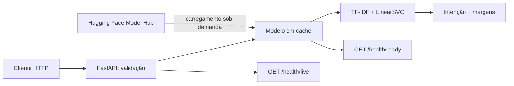
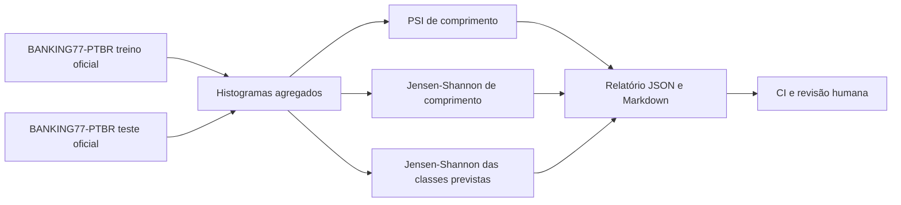

# ModelOps · decisões técnicas para servir e acompanhar um modelo NLP

**18 de novembro de 2026 · João Victor Albernaz**

Este documento registra as decisões de engenharia no projeto [ModelOps](../model-ops/), que integra o classificador de **77 intenções em português** do [BANKING77-PTBR](https://huggingface.co/JOAOOALBERNAZ/banking77-ptbr-intent-v1). É um laboratório de implementação e avaliação — **não um serviço financeiro em produção**.

## Contexto e escopo

Um modelo de ML não se encerra após o `fit()`: são necessários contrato de entrada, carregamento seguro, inferência, monitoramento de distribuição, validação automatizada e mecanismos de recuperação. A implementação deste laboratório cobre uma parte explícita dessas necessidades.

### Caminho de inferência

O modelo é serializado com `skops`, o que permite inspecionar os tipos antes de deserializar. O serviço rejeita tipos de artefato não reconhecidos. O carregamento é *lazy*, evitando acesso à rede no simples import do módulo. Há suporte a `MODEL_PATH` para execução local/offline com artefato previamente verificado.

### Caminho de monitoramento offline

Dados de pesquisa são utilizados para simular uma comparação de distribuições. **Não há fluxo de clientes reais** nem captura de conteúdo de usuários no relatório; somente totais por faixas e por classes são exportados.

## ADR-001 · Margens não são probabilidades

- **Decisão:** devolver as três maiores margens do `LinearSVC` e um *gap* de separação entre as duas primeiras.
- **Motivo:** o classificador publicado usa um SVM linear com `decision_function`, e não um `predict_proba()` calibrado.
- **Consequência:** `low_separation` usa um limite **ilustrativo** (0,15) apenas para sinalizar casos a analisar. O parâmetro não é validado em corpus independente nem pode substituir análise humana.
- **Alternativa para produção:** estimar calibração (por exemplo Platt ou isotônica, em validação independente) e definir política de abstenção com custo de falso positivo.

## ADR-002 · Readiness depende do modelo; liveness não

- **Decisão:** `/health/live` responde sem ler artefatos e `/health/ready` exige carregamento bem-sucedido.
- **Motivo:** um processo HTTP pode estar vivo, mas incapaz de realizar inferência.
- **Consequência:** falhas de download ou de serialização devem tornar o serviço *not ready*. As exceções internas não devem expor caminhos ou dados em respostas HTTP.
- **Limitação:** o repositório não implementa orquestração Kubernetes, balanceamento ou SLO de produção.

## ADR-003 · Monitoramento de distribuição é diagnóstico, não medição de qualidade

- **Decisão:** medir **PSI** e **divergência Jensen-Shannon em bits** em histogramas fixos de comprimento de mensagens e de classes previstas.
- **Motivo:** essas métricas funcionam sem conhecer rótulos verdadeiros de cada nova mensagem.
- **Consequência:** drift pode ocorrer sem queda de desempenho, e uma queda de desempenho pode ocorrer sem drift detectável. Nenhum alerta é prova de incidente.
- **Limitação:** os limiares PSI ≥ 0,2 e JSD ≥ 0,05 são heurísticos de demonstração, **sem calibração para custos reais**. Comparar divisões de pesquisa não equivale a monitorar produção.

## ADR-004 · Credenciais e privacidade

- **Implementado:** nenhuma chave de acesso embutida, download de modelo público, nenhum armazenamento persistente do texto submetido à API e publicação apenas de métricas agregadas.
- **Não implementado:** autenticação, rate-limiting, política de retenção, proteção contra abuso, auditoria operacional privada, criptografia em repouso de dados de clientes e controles de acesso por organização.
- **Risco:** uma API pública sem essas proteções não deve processar mensagens privadas nem decisões financeiras.

## ADR-005 · Reprodução e rollback

- **Implementado:** `Dockerfile`, modelos de teste determinísticos, testes da API, teste das fórmulas de PSI/JSD e pipeline CI. O experimento refere-se a uma fonte de modelo pública e documentada.
- **Para uma liberação real:** fixar o commit SHA do repositório do modelo, gerar SBOM, assinar imagem, executar smoke tests em ambiente isolado, implantar canário, comparar resultados com janela de referência e permitir rollback da imagem e do modelo de forma independente.
- **Motivo:** usar `main` como revisão do modelo simplifica a demonstração, mas não é suficiente para rastreabilidade em produção.

## Falhas e exercícios úteis para entrevista

| Falha simulada | Comportamento esperado | Evidência |
|:--|:--|:--|
| Texto vazio/fora de faixa | HTTP 422 | Testes do `PredictRequest` |
| Artefato ausente/inacessível | HTTP 503 de readiness | Dependência de carregamento protegida |
| Modelo retorna NaN/shape inválido | HTTP 503, sem predição | Teste de validação dos scores |
| Texto muito diferente do treino | Instrumentar drift, investigar e avaliar com humanos | PSI e JSD (não provam erro) |
| Alerta de drift sem rótulos reais | Não alegar queda de accuracy | Nota de interpretação no relatório |
| Model update errado | Recuperar versão anterior de modelo e imagem | Processo de rollback **proposto**, não implementado |

## Evidências reproduzíveis

- [Código da API](../model-ops/serving.py), [testes de contrato](../model-ops/tests/test_serving.py) e [Dockerfile](../model-ops/Dockerfile).
- [Monitor estatístico](../model-ops/monitor.py) e [testes das fórmulas](../model-ops/tests/test_monitor.py).
- [Modelo treinado no Hugging Face](https://huggingface.co/JOAOOALBERNAZ/banking77-ptbr-intent-v1).
- [Dataset e auditoria da avaliação](./banking77-ptbr-results.md).
- [Workflow CI de serving e drift](../../.github/workflows/modelops-ci.yml).

**Conclusão:** a principal evidência do projeto está na separação entre **modelo**, **inferência**, **disponibilidade** e **qualidade**. São preocupações diferentes e exigem testes diferentes.
