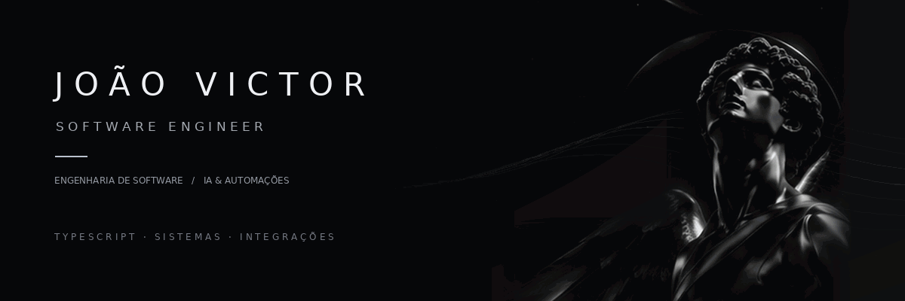
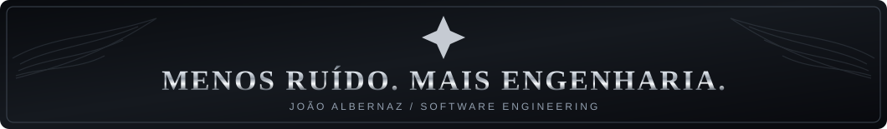

<!--
  FONTE DO README — edite este arquivo, não o README.md.
  Para gerar de novo (na raiz do repo):
    npx readme-aura@1.0.20 build --fonts-dir .github/fonts
    node .github/scripts/fix-nested-svg.mjs
  O segundo comando corrige um bug do readme-aura que esconde SVGs internos (ícones, órbita, cursor).
  Os blocks ```aura são JSX (Satori) convertidos em SVG animado em .github/assets.
-->

<div align="center">

</div>

```aura width=176 height=50 inline align=center link="https://www.linkedin.com/in/joaooalbernaz/"
<div style={{ display: 'flex', width: '100%', height: '100%', padding: 4 }}>
  <style>{`
    @keyframes sweep { 0% { transform: translateX(-120px); } 55%, 100% { transform: translateX(220px); } }
    #sw { animation: sweep 4.5s ease-in-out infinite; }
  `}</style>
  <div style={{ display: 'flex', width: '100%', height: '100%', borderRadius: 999, padding: 1, backgroundImage: 'linear-gradient(180deg, #8d96a1 0%, #2a3038 45%, #c9d1da 100%)' }}>
    <div style={{ display: 'flex', position: 'relative', overflow: 'hidden', alignItems: 'center', justifyContent: 'center', width: '100%', height: '100%', borderRadius: 999, backgroundImage: 'linear-gradient(180deg, #1a1f26 0%, #0b0d12 100%)', gap: 10 }}>
      <svg width="168" height="42" style={{ position: 'absolute', top: 0, left: 0 }}>
        <defs><linearGradient id="shine" x1="0" y1="0" x2="1" y2="0"><stop offset="0%" stopColor="rgba(255,255,255,0)" /><stop offset="50%" stopColor="rgba(235,240,247,0.22)" /><stop offset="100%" stopColor="rgba(255,255,255,0)" /></linearGradient></defs>
        <rect id="sw" x="0" y="-10" width="60" height="62" fill="url(#shine)" transform="skewX(-20)" />
      </svg>
      <svg width="16" height="16"><g transform="scale(0.6667)"><rect x="2" y="2" width="20" height="20" rx="4" fill="none" stroke="#d9e0e8" strokeWidth="1.8" /><rect x="6.5" y="10" width="2.4" height="7.5" fill="#d9e0e8" /><circle cx="7.7" cy="7" r="1.4" fill="#d9e0e8" /><path d="M11.5 17.5V10h2.3v1.1c.5-.8 1.4-1.3 2.5-1.3 1.9 0 2.9 1.2 2.9 3.4v4.3h-2.4v-3.9c0-1-.4-1.6-1.3-1.6s-1.6.7-1.6 1.7v3.8z" fill="#d9e0e8" /></g></svg>
      <div style={{ display: 'flex', fontFamily: 'InterStrong', fontSize: 13, letterSpacing: 2.5, color: '#e6ebf1' }}>LINKEDIN</div>
    </div>
  </div>
</div>
```

```aura width=176 height=50 inline align=center link="mailto:joaovictoralbernaz@gmail.com"
<div style={{ display: 'flex', width: '100%', height: '100%', padding: 4 }}>
  <style>{`
    @keyframes sweep { 0%, 20% { transform: translateX(-120px); } 75%, 100% { transform: translateX(220px); } }
    #sw { animation: sweep 4.5s ease-in-out infinite; }
  `}</style>
  <div style={{ display: 'flex', width: '100%', height: '100%', borderRadius: 999, padding: 1, backgroundImage: 'linear-gradient(180deg, #8d96a1 0%, #2a3038 45%, #c9d1da 100%)' }}>
    <div style={{ display: 'flex', position: 'relative', overflow: 'hidden', alignItems: 'center', justifyContent: 'center', width: '100%', height: '100%', borderRadius: 999, backgroundImage: 'linear-gradient(180deg, #1a1f26 0%, #0b0d12 100%)', gap: 10 }}>
      <svg width="168" height="42" style={{ position: 'absolute', top: 0, left: 0 }}>
        <defs><linearGradient id="shine" x1="0" y1="0" x2="1" y2="0"><stop offset="0%" stopColor="rgba(255,255,255,0)" /><stop offset="50%" stopColor="rgba(235,240,247,0.22)" /><stop offset="100%" stopColor="rgba(255,255,255,0)" /></linearGradient></defs>
        <rect id="sw" x="0" y="-10" width="60" height="62" fill="url(#shine)" transform="skewX(-20)" />
      </svg>
      <svg width="17" height="17"><g transform="scale(0.7083)"><rect x="2.5" y="5" width="19" height="14" rx="2.5" fill="none" stroke="#d9e0e8" strokeWidth="1.8" /><path d="M3.5 6.5l8.5 6.5 8.5-6.5" fill="none" stroke="#d9e0e8" strokeWidth="1.8" /></g></svg>
      <div style={{ display: 'flex', fontFamily: 'InterStrong', fontSize: 13, letterSpacing: 2.5, color: '#e6ebf1' }}>E-MAIL</div>
    </div>
  </div>
</div>
```

```aura width=208 height=50 inline align=center link="https://github.com/JoaoAlbernaz1?tab=repositories"
<div style={{ display: 'flex', width: '100%', height: '100%', padding: 4 }}>
  <style>{`
    @keyframes sweep { 0%, 40% { transform: translateX(-120px); } 95%, 100% { transform: translateX(260px); } }
    #sw { animation: sweep 4.5s ease-in-out infinite; }
  `}</style>
  <div style={{ display: 'flex', width: '100%', height: '100%', borderRadius: 999, padding: 1, backgroundImage: 'linear-gradient(180deg, #8d96a1 0%, #2a3038 45%, #c9d1da 100%)' }}>
    <div style={{ display: 'flex', position: 'relative', overflow: 'hidden', alignItems: 'center', justifyContent: 'center', width: '100%', height: '100%', borderRadius: 999, backgroundImage: 'linear-gradient(180deg, #1a1f26 0%, #0b0d12 100%)', gap: 10 }}>
      <svg width="200" height="42" style={{ position: 'absolute', top: 0, left: 0 }}>
        <defs><linearGradient id="shine" x1="0" y1="0" x2="1" y2="0"><stop offset="0%" stopColor="rgba(255,255,255,0)" /><stop offset="50%" stopColor="rgba(235,240,247,0.22)" /><stop offset="100%" stopColor="rgba(255,255,255,0)" /></linearGradient></defs>
        <rect id="sw" x="0" y="-10" width="60" height="62" fill="url(#shine)" transform="skewX(-20)" />
      </svg>
      <svg width="16" height="16"><g transform="scale(0.6667)"><path d="M5 3.5h11.5a2 2 0 0 1 2 2V18H6.5A1.5 1.5 0 0 0 5 19.5z" fill="none" stroke="#d9e0e8" strokeWidth="1.8" /><path d="M5 19.5A1.5 1.5 0 0 0 6.5 21h12V18" fill="none" stroke="#d9e0e8" strokeWidth="1.8" /><path d="M9 3.5v6l2-1.4 2 1.4v-6" fill="#d9e0e8" /></g></svg>
      <div style={{ display: 'flex', fontFamily: 'InterStrong', fontSize: 13, letterSpacing: 2.5, color: '#e6ebf1' }}>REPOSITÓRIOS</div>
    </div>
  </div>
</div>
```

```aura width=800 height=340
<div style={{ display: 'flex', width: '100%', height: '100%', gap: 12 }}>
  <style>{`
    @keyframes aura-a { 0%, 100% { transform: translate(0, 0); opacity: .75; } 50% { transform: translate(70px, 26px); opacity: 1; } }
    @keyframes aura-b { 0%, 100% { transform: translate(0, 0); opacity: .55; } 50% { transform: translate(-60px, -18px); opacity: .9; } }
    @keyframes blink { 0%, 49% { opacity: 1; } 50%, 100% { opacity: 0; } }
    @keyframes spin { to { transform: rotate(360deg); } }
    @keyframes twinkle { 0%, 100% { transform: scale(.82); opacity: .7; } 50% { transform: scale(1.06); opacity: 1; } }
    @keyframes ring { 0% { transform: scale(.6); opacity: .55; } 100% { transform: scale(1.5); opacity: 0; } }
    #a1 { animation: aura-a 11s ease-in-out infinite; }
    #a2 { animation: aura-b 13s ease-in-out infinite 1s; }
    #a3 { animation: aura-a 9s ease-in-out infinite 2.5s; }
    #cur { animation: blink 1.1s infinite; }
    #orb { transform-box: fill-box; transform-origin: center; animation: spin 16s linear infinite; }
    #star { transform-box: fill-box; transform-origin: center; animation: twinkle 3.2s ease-in-out infinite; }
    #halo { transform-box: fill-box; transform-origin: center; animation: ring 3.2s ease-out infinite; }
  `}</style>

  <div style={{ display: 'flex', flexDirection: 'column', justifyContent: 'space-between', position: 'relative', overflow: 'hidden', width: 520, height: '100%', borderRadius: 18, border: '1px solid #2c333c', backgroundImage: 'linear-gradient(160deg, #161a21 0%, #0b0d12 55%, #08090d 100%)', padding: 30 }}>
    <svg width="520" height="340" style={{ position: 'absolute', top: 0, left: 0 }}>
      <defs>
        <radialGradient id="s1" cx="50%" cy="50%" r="50%"><stop offset="0%" stopColor="rgba(214,222,232,0.30)" /><stop offset="100%" stopColor="rgba(214,222,232,0)" /></radialGradient>
        <radialGradient id="s2" cx="50%" cy="50%" r="50%"><stop offset="0%" stopColor="rgba(140,152,168,0.30)" /><stop offset="100%" stopColor="rgba(140,152,168,0)" /></radialGradient>
        <radialGradient id="s3" cx="50%" cy="50%" r="50%"><stop offset="0%" stopColor="rgba(250,252,255,0.16)" /><stop offset="100%" stopColor="rgba(250,252,255,0)" /></radialGradient>
        <linearGradient id="ln" x1="0" y1="0" x2="1" y2="0"><stop offset="0%" stopColor="rgba(196,204,214,0)" /><stop offset="50%" stopColor="rgba(196,204,214,0.5)" /><stop offset="100%" stopColor="rgba(196,204,214,0)" /></linearGradient>
      </defs>
      <ellipse id="a1" cx="430" cy="40" rx="230" ry="150" fill="url(#s1)" />
      <ellipse id="a2" cx="120" cy="320" rx="260" ry="130" fill="url(#s2)" />
      <ellipse id="a3" cx="300" cy="180" rx="160" ry="110" fill="url(#s3)" />
      <path d="M300 340 C 380 250, 450 210, 540 190" fill="none" stroke="rgba(196,204,214,0.10)" />
      <path d="M330 340 C 400 260, 460 230, 540 220" fill="none" stroke="rgba(196,204,214,0.08)" />
      <path d="M360 340 C 420 275, 470 250, 540 248" fill="none" stroke="rgba(196,204,214,0.06)" />
      <rect x="0" y="0" width="520" height="1" fill="url(#ln)" />
    </svg>
    <div style={{ display: 'flex', flexDirection: 'column' }}>
      <div style={{ display: 'flex', fontFamily: 'JetBrainsMono', fontSize: 11, letterSpacing: 3, color: '#7d8793' }}>01 / ABOUT THE ENGINEER</div>
      <div style={{ display: 'flex', marginTop: 18, fontFamily: 'Cinzel', fontSize: 32, lineHeight: 1.15, backgroundImage: 'linear-gradient(180deg, #636c77 0%, #e1e7ee 28%, #929aa4 52%, #fbfdff 74%, #59616b 100%)', backgroundClip: 'text', color: 'transparent' }}>Construo produtos de ponta a ponta.</div>
      <div style={{ display: 'flex', marginTop: 16, fontFamily: 'Inter', fontSize: 15, lineHeight: 1.55, color: '#aeb7c2' }}>Frontend, backend, banco de dados, integrações e automação com IA — do primeiro protótipo à operação, com arquitetura e qualidade de código.</div>
    </div>
    <div style={{ display: 'flex', alignItems: 'center' }}>
      <div style={{ display: 'flex', fontFamily: 'JetBrainsMono', fontSize: 12.5, color: '#8a94a0' }}>&gt; aberto a oportunidades em engenharia e GenAI</div>
      <svg width="12" height="18" style={{ marginLeft: 4 }}><rect id="cur" x="1" y="2" width="8" height="15" fill="#d9e0e8" /></svg>
    </div>
  </div>

  <div style={{ display: 'flex', flexDirection: 'column', width: 268, height: '100%', gap: 12 }}>
    <div style={{ display: 'flex', flexDirection: 'column', justifyContent: 'space-between', position: 'relative', overflow: 'hidden', width: '100%', height: 164, borderRadius: 18, border: '1px solid #2c333c', backgroundImage: 'linear-gradient(200deg, #171b22 0%, #0a0c10 70%)', padding: 22 }}>
      <svg width="268" height="164" style={{ position: 'absolute', top: 0, left: 0 }}>
        <defs><radialGradient id="s4" cx="50%" cy="50%" r="50%"><stop offset="0%" stopColor="rgba(214,222,232,0.20)" /><stop offset="100%" stopColor="rgba(214,222,232,0)" /></radialGradient></defs>
        <ellipse cx="210" cy="56" rx="120" ry="90" fill="url(#s4)" />
        <circle cx="206" cy="58" r="34" fill="none" stroke="rgba(196,204,214,0.22)" strokeDasharray="3 6" />
        <circle cx="206" cy="58" r="17" fill="none" stroke="rgba(196,204,214,0.30)" />
        <g id="orb">
          <circle cx="206" cy="58" r="34" fill="none" stroke="rgba(0,0,0,0)" />
          <circle cx="240" cy="58" r="4" fill="#e6ebf1" />
          <circle cx="172" cy="58" r="3" fill="#8a94a0" />
          <circle cx="206" cy="24" r="2.5" fill="#c4ccd6" />
        </g>
        <circle cx="206" cy="58" r="5" fill="#f5f7fb" />
      </svg>
      <div style={{ display: 'flex', fontFamily: 'JetBrainsMono', fontSize: 10.5, letterSpacing: 3, color: '#7d8793' }}>FOCO</div>
      <div style={{ display: 'flex', flexDirection: 'column' }}>
        <div style={{ display: 'flex', fontFamily: 'InterStrong', fontSize: 18, color: '#eef2f6' }}>Agentes &amp; LLMs</div>
        <div style={{ display: 'flex', marginTop: 4, fontFamily: 'JetBrainsMono', fontSize: 11, color: '#8a94a0' }}>n8n · OpenAI · Claude API</div>
      </div>
    </div>

    <div style={{ display: 'flex', flexDirection: 'column', justifyContent: 'space-between', position: 'relative', overflow: 'hidden', width: '100%', height: 164, borderRadius: 18, border: '1px solid #2c333c', backgroundImage: 'linear-gradient(160deg, #171b22 0%, #0a0c10 70%)', padding: 22 }}>
      <svg width="268" height="164" style={{ position: 'absolute', top: 0, left: 0 }}>
        <defs>
          <radialGradient id="s5" cx="50%" cy="50%" r="50%"><stop offset="0%" stopColor="rgba(240,244,250,0.22)" /><stop offset="100%" stopColor="rgba(240,244,250,0)" /></radialGradient>
          <linearGradient id="chrome" x1="0" y1="0" x2="0" y2="1"><stop offset="0%" stopColor="#fbfdff" /><stop offset="45%" stopColor="#9aa3ad" /><stop offset="70%" stopColor="#e1e7ee" /><stop offset="100%" stopColor="#59616b" /></linearGradient>
        </defs>
        <ellipse cx="208" cy="58" rx="110" ry="85" fill="url(#s5)" />
        <circle id="halo" cx="208" cy="58" r="26" fill="none" stroke="rgba(214,222,232,0.6)" />
        <path id="star" d="M208 30 C 211 50, 216 55, 236 58 C 216 61, 211 66, 208 86 C 205 66, 200 61, 180 58 C 200 55, 205 50, 208 30 Z" fill="url(#chrome)" />
      </svg>
      <div style={{ display: 'flex', fontFamily: 'JetBrainsMono', fontSize: 10.5, letterSpacing: 3, color: '#7d8793' }}>BASE</div>
      <div style={{ display: 'flex', flexDirection: 'column' }}>
        <div style={{ display: 'flex', fontFamily: 'InterStrong', fontSize: 18, color: '#eef2f6' }}>Brasília · UCB</div>
        <div style={{ display: 'flex', marginTop: 4, fontFamily: 'JetBrainsMono', fontSize: 11, color: '#8a94a0' }}>Engenharia de Software</div>
      </div>
    </div>
  </div>
</div>
```

```aura width=800 height=356
<div style={{ display: 'flex', flexDirection: 'column', position: 'relative', overflow: 'hidden', width: '100%', height: '100%', borderRadius: 18, border: '1px solid #2c333c', backgroundImage: 'linear-gradient(170deg, #151920 0%, #0b0d12 60%, #08090d 100%)', padding: 28 }}>
  <style>{`
    @keyframes shimmer { 0% { transform: translateX(-260px); } 60%, 100% { transform: translateX(1000px); } }
    @keyframes aura-c { 0%, 100% { transform: translate(0, 0); opacity: .6; } 50% { transform: translate(-80px, 20px); opacity: 1; } }
    #sh { animation: shimmer 7s ease-in-out infinite; }
    #a4 { animation: aura-c 12s ease-in-out infinite; }
  `}</style>
  <svg width="800" height="356" style={{ position: 'absolute', top: 0, left: 0 }}>
    <defs>
      <radialGradient id="s6" cx="50%" cy="50%" r="50%"><stop offset="0%" stopColor="rgba(200,208,220,0.18)" /><stop offset="100%" stopColor="rgba(200,208,220,0)" /></radialGradient>
      <linearGradient id="band" x1="0" y1="0" x2="1" y2="0"><stop offset="0%" stopColor="rgba(255,255,255,0)" /><stop offset="50%" stopColor="rgba(230,236,244,0.07)" /><stop offset="100%" stopColor="rgba(255,255,255,0)" /></linearGradient>
      <linearGradient id="ln2" x1="0" y1="0" x2="1" y2="0"><stop offset="0%" stopColor="rgba(196,204,214,0.05)" /><stop offset="50%" stopColor="rgba(196,204,214,0.45)" /><stop offset="100%" stopColor="rgba(196,204,214,0.05)" /></linearGradient>
    </defs>
    <ellipse id="a4" cx="680" cy="40" rx="260" ry="140" fill="url(#s6)" />
    <rect id="sh" x="0" y="-40" width="200" height="440" fill="url(#band)" transform="skewX(-18)" />
    <rect x="28" y="82" width="744" height="1" fill="url(#ln2)" />
  </svg>

  <div style={{ display: 'flex', justifyContent: 'space-between', alignItems: 'flex-end', height: 44 }}>
    <div style={{ display: 'flex', fontFamily: 'Cinzel', fontSize: 26, letterSpacing: 2, backgroundImage: 'linear-gradient(180deg, #636c77 0%, #e1e7ee 28%, #929aa4 52%, #fbfdff 74%, #59616b 100%)', backgroundClip: 'text', color: 'transparent' }}>LANGUAGES &amp; STACK</div>
    <div style={{ display: 'flex', fontFamily: 'JetBrainsMono', fontSize: 11, letterSpacing: 3, color: '#7d8793', marginBottom: 6 }}>02 / DESIGN · BUILD · SHIP</div>
  </div>

  <div style={{ display: 'flex', flexWrap: 'wrap', gap: 8, marginTop: 30 }}>
    {[['TS', 'TypeScript'], ['JS', 'JavaScript'], ['PY', 'Python'], ['JV', 'Java'], ['C', 'C']].map(([a, b]) => (
      <div style={{ display: 'flex', alignItems: 'center', gap: 8, padding: '6px 13px 6px 7px', borderRadius: 10, border: '1px solid #3d4651', backgroundImage: 'linear-gradient(180deg, #1c2129 0%, #0f1217 100%)' }}>
        <div style={{ display: 'flex', alignItems: 'center', justifyContent: 'center', width: 26, height: 22, borderRadius: 6, border: '1px solid #4a535e', fontFamily: 'InterStrong', fontSize: 10.5, color: '#e1e7ee' }}>{a}</div>
        <div style={{ display: 'flex', fontFamily: 'InterStrong', fontSize: 13, color: '#e6ebf1' }}>{b}</div>
      </div>
    ))}
    {[['GO', 'Go'], ['KT', 'Kotlin']].map(([a, b]) => (
      <div style={{ display: 'flex', alignItems: 'center', gap: 8, padding: '6px 13px 6px 7px', borderRadius: 10, border: '1px dashed #4a535e' }}>
        <div style={{ display: 'flex', alignItems: 'center', justifyContent: 'center', width: 26, height: 22, borderRadius: 6, border: '1px dashed #4a535e', fontFamily: 'InterStrong', fontSize: 10.5, color: '#8a94a0' }}>{a}</div>
        <div style={{ display: 'flex', fontFamily: 'InterStrong', fontSize: 13, color: '#8a94a0' }}>{b}</div>
      </div>
    ))}
  </div>

  <div style={{ display: 'flex', gap: 12, marginTop: 22 }}>
    {[
      ['01 / UI · APP', 'FRONTEND', ['React', 'Next.js', 'React Native', 'Expo']],
      ['02 / SERVICES', 'BACKEND', ['Node.js', 'NestJS', 'REST', 'Prisma']],
      ['03 / AGENTS', 'GENAI / AUTO', ['n8n', 'Make', 'OpenAI', 'Claude']],
      ['04 / SYSTEMS', 'DATA / OPS', ['PostgreSQL', 'Supabase', 'Redis', 'Docker']],
    ].map(([k, t, items]) => (
      <div style={{ display: 'flex', flexDirection: 'column', width: 177, padding: 14, borderRadius: 12, border: '1px solid #2c333c', backgroundColor: 'rgba(12,14,19,0.75)' }}>
        <div style={{ display: 'flex', fontFamily: 'JetBrainsMono', fontSize: 9.5, letterSpacing: 2, color: '#7d8793' }}>{k}</div>
        <div style={{ display: 'flex', marginTop: 6, fontFamily: 'Cinzel', fontSize: 15, color: '#e1e7ee' }}>{t}</div>
        <div style={{ display: 'flex', flexWrap: 'wrap', gap: 5, marginTop: 10 }}>
          {items.map((i) => (
            <div style={{ display: 'flex', padding: '3px 8px', borderRadius: 6, backgroundColor: '#161a20', border: '1px solid #262c34', fontFamily: 'JetBrainsMono', fontSize: 10.5, color: '#b8c1cc' }}>{i}</div>
          ))}
        </div>
      </div>
    ))}
  </div>

  <div style={{ display: 'flex', marginTop: 18, fontFamily: 'JetBrainsMono', fontSize: 10, letterSpacing: 1.5, color: '#6b7480' }}>SÓLIDO = EM USO  ·  TRACEJADO = EM EXPLORAÇÃO  ·  QUALIDADE: VITEST · JEST · PYTEST</div>
</div>
```

```aura width=800 height=64
<div style={{ display: 'flex', justifyContent: 'space-between', alignItems: 'center', width: '100%', height: '100%', padding: '0 26px', position: 'relative', overflow: 'hidden', borderRadius: 16, border: '1px solid #2c333c', backgroundImage: 'linear-gradient(170deg, #151920 0%, #0b0d12 60%, #08090d 100%)' }}>
  <svg width="800" height="64" style={{ position: 'absolute', top: 0, left: 0 }}>
    <defs><linearGradient id="ln3" x1="0" y1="0" x2="1" y2="0"><stop offset="0%" stopColor="rgba(196,204,214,0)" /><stop offset="50%" stopColor="rgba(196,204,214,0.5)" /><stop offset="100%" stopColor="rgba(196,204,214,0)" /></linearGradient></defs>
    <rect x="0" y="0" width="800" height="1" fill="url(#ln3)" />
  </svg>
  <div style={{ display: 'flex', fontFamily: 'Cinzel', fontSize: 26, letterSpacing: 2, backgroundImage: 'linear-gradient(180deg, #636c77 0%, #e1e7ee 28%, #929aa4 52%, #fbfdff 74%, #59616b 100%)', backgroundClip: 'text', color: 'transparent' }}>SELECTED PROJECTS</div>
  <div style={{ display: 'flex', fontFamily: 'JetBrainsMono', fontSize: 11, letterSpacing: 3, color: '#7d8793' }}>03 / PROJETOS REAIS · GENAI</div>
</div>
```

```aura width=400 height=262 inline align=center
<div style={{ display: 'flex', width: '100%', height: '100%', padding: 6 }}>
  <style>{`
    @keyframes aura-p { 0%, 100% { transform: translate(0, 0); opacity: .6; } 50% { transform: translate(-40px, 22px); opacity: 1; } }
    #ap { animation: aura-p 10s ease-in-out infinite; }
  `}</style>
  <div style={{ display: 'flex', flexDirection: 'column', justifyContent: 'space-between', position: 'relative', overflow: 'hidden', width: '100%', height: '100%', borderRadius: 16, border: '1px solid #2c333c', backgroundImage: 'linear-gradient(165deg, #161a21 0%, #0b0d12 60%, #08090d 100%)', padding: 22 }}>
    <svg width="388" height="250" style={{ position: 'absolute', top: 0, left: 0 }}>
      <defs><radialGradient id="sp" cx="50%" cy="50%" r="50%"><stop offset="0%" stopColor="rgba(214,222,232,0.22)" /><stop offset="100%" stopColor="rgba(214,222,232,0)" /></radialGradient></defs>
      <ellipse id="ap" cx="330" cy="30" rx="170" ry="110" fill="url(#sp)" />
    </svg>
    <div style={{ display: 'flex', flexDirection: 'column' }}>
      <div style={{ display: 'flex', justifyContent: 'space-between', alignItems: 'center' }}>
        <div style={{ display: 'flex', fontFamily: 'Cinzel', fontSize: 30, backgroundImage: 'linear-gradient(180deg, #636c77 0%, #e1e7ee 28%, #929aa4 52%, #fbfdff 74%, #59616b 100%)', backgroundClip: 'text', color: 'transparent' }}>01</div>
        <div style={{ display: 'flex', padding: '4px 10px', borderRadius: 999, border: '1px solid #3d4651', fontFamily: 'JetBrainsMono', fontSize: 9.5, letterSpacing: 2, color: '#8a94a0' }}>PRIVADO</div>
      </div>
      <div style={{ display: 'flex', marginTop: 8, fontFamily: 'InterStrong', fontSize: 20, color: '#eef2f6' }}>Selena</div>
      <div style={{ display: 'flex', marginTop: 2, fontFamily: 'JetBrainsMono', fontSize: 10.5, letterSpacing: 2, color: '#7d8793' }}>ASSISTENTE LEGISLATIVA</div>
      <div style={{ display: 'flex', marginTop: 10, fontFamily: 'Inter', fontSize: 13, lineHeight: 1.5, color: '#aab4bf' }}>Automações e IA integradas a sistemas e processos internos, com orquestração de rotinas, agentes e WhatsApp.</div>
    </div>
    <div style={{ display: 'flex', gap: 6 }}>
      {['n8n', 'GenAI', 'WhatsApp', 'Webhooks'].map((t) => (
        <div style={{ display: 'flex', padding: '3px 8px', borderRadius: 6, backgroundColor: '#161a20', border: '1px solid #262c34', fontFamily: 'JetBrainsMono', fontSize: 10.5, color: '#b8c1cc' }}>{t}</div>
      ))}
    </div>
  </div>
</div>
```

```aura width=400 height=262 inline align=center
<div style={{ display: 'flex', width: '100%', height: '100%', padding: 6 }}>
  <style>{`
    @keyframes aura-p { 0%, 100% { transform: translate(0, 0); opacity: .6; } 50% { transform: translate(40px, -18px); opacity: 1; } }
    #ap { animation: aura-p 12s ease-in-out infinite 1.5s; }
  `}</style>
  <div style={{ display: 'flex', flexDirection: 'column', justifyContent: 'space-between', position: 'relative', overflow: 'hidden', width: '100%', height: '100%', borderRadius: 16, border: '1px solid #2c333c', backgroundImage: 'linear-gradient(195deg, #161a21 0%, #0b0d12 60%, #08090d 100%)', padding: 22 }}>
    <svg width="388" height="250" style={{ position: 'absolute', top: 0, left: 0 }}>
      <defs><radialGradient id="sp" cx="50%" cy="50%" r="50%"><stop offset="0%" stopColor="rgba(214,222,232,0.20)" /><stop offset="100%" stopColor="rgba(214,222,232,0)" /></radialGradient></defs>
      <ellipse id="ap" cx="60" cy="230" rx="180" ry="100" fill="url(#sp)" />
    </svg>
    <div style={{ display: 'flex', flexDirection: 'column' }}>
      <div style={{ display: 'flex', justifyContent: 'space-between', alignItems: 'center' }}>
        <div style={{ display: 'flex', fontFamily: 'Cinzel', fontSize: 30, backgroundImage: 'linear-gradient(180deg, #636c77 0%, #e1e7ee 28%, #929aa4 52%, #fbfdff 74%, #59616b 100%)', backgroundClip: 'text', color: 'transparent' }}>02</div>
        <div style={{ display: 'flex', padding: '4px 10px', borderRadius: 999, border: '1px solid #3d4651', fontFamily: 'JetBrainsMono', fontSize: 9.5, letterSpacing: 2, color: '#8a94a0' }}>PRIVADO</div>
      </div>
      <div style={{ display: 'flex', marginTop: 8, fontFamily: 'InterStrong', fontSize: 20, color: '#eef2f6' }}>SeuConvite IA</div>
      <div style={{ display: 'flex', marginTop: 2, fontFamily: 'JetBrainsMono', fontSize: 10.5, letterSpacing: 2, color: '#7d8793' }}>SAAS PARA EVENTOS</div>
      <div style={{ display: 'flex', marginTop: 10, fontFamily: 'Inter', fontSize: 13, lineHeight: 1.5, color: '#aab4bf' }}>Sites de eventos multi-tenant com subdomínios, painel administrativo, autenticação e geração de imagens com IA.</div>
    </div>
    <div style={{ display: 'flex', gap: 6 }}>
      {['Next.js', 'TypeScript', 'Prisma', 'OpenAI'].map((t) => (
        <div style={{ display: 'flex', padding: '3px 8px', borderRadius: 6, backgroundColor: '#161a20', border: '1px solid #262c34', fontFamily: 'JetBrainsMono', fontSize: 10.5, color: '#b8c1cc' }}>{t}</div>
      ))}
    </div>
  </div>
</div>
```

```aura width=400 height=262 inline align=center link="https://github.com/JoaoAlbernaz1/UniMove"
<div style={{ display: 'flex', width: '100%', height: '100%', padding: 6 }}>
  <style>{`
    @keyframes aura-p { 0%, 100% { transform: translate(0, 0); opacity: .6; } 50% { transform: translate(-30px, -24px); opacity: 1; } }
    #ap { animation: aura-p 11s ease-in-out infinite .8s; }
  `}</style>
  <div style={{ display: 'flex', flexDirection: 'column', justifyContent: 'space-between', position: 'relative', overflow: 'hidden', width: '100%', height: '100%', borderRadius: 16, border: '1px solid #3d4651', backgroundImage: 'linear-gradient(165deg, #181c23 0%, #0b0d12 60%, #08090d 100%)', padding: 22 }}>
    <svg width="388" height="250" style={{ position: 'absolute', top: 0, left: 0 }}>
      <defs><radialGradient id="sp" cx="50%" cy="50%" r="50%"><stop offset="0%" stopColor="rgba(230,236,244,0.24)" /><stop offset="100%" stopColor="rgba(230,236,244,0)" /></radialGradient></defs>
      <ellipse id="ap" cx="340" cy="220" rx="170" ry="110" fill="url(#sp)" />
    </svg>
    <div style={{ display: 'flex', flexDirection: 'column' }}>
      <div style={{ display: 'flex', justifyContent: 'space-between', alignItems: 'center' }}>
        <div style={{ display: 'flex', fontFamily: 'Cinzel', fontSize: 30, backgroundImage: 'linear-gradient(180deg, #636c77 0%, #e1e7ee 28%, #929aa4 52%, #fbfdff 74%, #59616b 100%)', backgroundClip: 'text', color: 'transparent' }}>03</div>
        <div style={{ display: 'flex', padding: '4px 10px', borderRadius: 999, border: '1px solid #c4ccd6', backgroundColor: '#e6ebf1', fontFamily: 'JetBrainsMono', fontSize: 9.5, letterSpacing: 2, color: '#0b0d12', gap: 5, alignItems: 'center' }}>PÚBLICO<svg width="9" height="9"><g transform="scale(0.9000)"><path d="M2 8L8 2M3.5 2H8v4.5" fill="none" stroke="#0b0d12" strokeWidth="1.5" /></g></svg></div>
      </div>
      <div style={{ display: 'flex', marginTop: 8, fontFamily: 'InterStrong', fontSize: 20, color: '#eef2f6' }}>UniMove</div>
      <div style={{ display: 'flex', marginTop: 2, fontFamily: 'JetBrainsMono', fontSize: 10.5, letterSpacing: 2, color: '#7d8793' }}>APP DE CARONAS + API</div>
      <div style={{ display: 'flex', marginTop: 10, fontFamily: 'Inter', fontSize: 13, lineHeight: 1.5, color: '#aab4bf' }}>Plataforma acadêmica de caronas: app mobile, API REST, autenticação, veículos, reservas e chat em tempo real.</div>
    </div>
    <div style={{ display: 'flex', gap: 6 }}>
      {['React Native', 'NestJS', 'PostgreSQL', 'Prisma'].map((t) => (
        <div style={{ display: 'flex', padding: '3px 8px', borderRadius: 6, backgroundColor: '#161a20', border: '1px solid #262c34', fontFamily: 'JetBrainsMono', fontSize: 10.5, color: '#b8c1cc' }}>{t}</div>
      ))}
    </div>
  </div>
</div>
```

```aura width=400 height=262 inline align=center
<div style={{ display: 'flex', width: '100%', height: '100%', padding: 6 }}>
  <style>{`
    @keyframes aura-p { 0%, 100% { transform: translate(0, 0); opacity: .6; } 50% { transform: translate(36px, 20px); opacity: 1; } }
    #ap { animation: aura-p 13s ease-in-out infinite 2s; }
  `}</style>
  <div style={{ display: 'flex', flexDirection: 'column', justifyContent: 'space-between', position: 'relative', overflow: 'hidden', width: '100%', height: '100%', borderRadius: 16, border: '1px solid #2c333c', backgroundImage: 'linear-gradient(195deg, #161a21 0%, #0b0d12 60%, #08090d 100%)', padding: 22 }}>
    <svg width="388" height="250" style={{ position: 'absolute', top: 0, left: 0 }}>
      <defs><radialGradient id="sp" cx="50%" cy="50%" r="50%"><stop offset="0%" stopColor="rgba(214,222,232,0.20)" /><stop offset="100%" stopColor="rgba(214,222,232,0)" /></radialGradient></defs>
      <ellipse id="ap" cx="50" cy="30" rx="180" ry="100" fill="url(#sp)" />
      <path d="M215 236 C 270 232, 300 214, 318 196 S 350 170, 388 166" fill="none" stroke="rgba(196,204,214,0.24)" strokeWidth="1.5" />
      <path d="M215 240 C 275 238, 305 226, 322 212 S 355 190, 388 188" fill="none" stroke="rgba(196,204,214,0.10)" strokeWidth="1.5" strokeDasharray="4 5" />
    </svg>
    <div style={{ display: 'flex', flexDirection: 'column' }}>
      <div style={{ display: 'flex', justifyContent: 'space-between', alignItems: 'center' }}>
        <div style={{ display: 'flex', fontFamily: 'Cinzel', fontSize: 30, backgroundImage: 'linear-gradient(180deg, #636c77 0%, #e1e7ee 28%, #929aa4 52%, #fbfdff 74%, #59616b 100%)', backgroundClip: 'text', color: 'transparent' }}>04</div>
        <div style={{ display: 'flex', padding: '4px 10px', borderRadius: 999, border: '1px solid #3d4651', fontFamily: 'JetBrainsMono', fontSize: 9.5, letterSpacing: 2, color: '#8a94a0' }}>PRIVADO</div>
      </div>
      <div style={{ display: 'flex', marginTop: 8, fontFamily: 'InterStrong', fontSize: 20, color: '#eef2f6' }}>Curva S</div>
      <div style={{ display: 'flex', marginTop: 2, fontFamily: 'JetBrainsMono', fontSize: 10.5, letterSpacing: 2, color: '#7d8793' }}>AVANÇO FÍSICO DE PROJETOS</div>
      <div style={{ display: 'flex', marginTop: 10, fontFamily: 'Inter', fontSize: 13, lineHeight: 1.5, color: '#aab4bf' }}>Painel gerencial com importação de cronogramas, planejado x realizado e visualizações de progresso.</div>
    </div>
    <div style={{ display: 'flex', gap: 6 }}>
      {['React', 'TypeScript', 'Vitest'].map((t) => (
        <div style={{ display: 'flex', padding: '3px 8px', borderRadius: 6, backgroundColor: '#161a20', border: '1px solid #262c34', fontFamily: 'JetBrainsMono', fontSize: 10.5, color: '#b8c1cc' }}>{t}</div>
      ))}
    </div>
  </div>
</div>
```

<details>
<summary><b>+ OTHER WORK / MAIS PROJETOS</b></summary>

<br/>

**Finanças Bot** — Assistente privado com TypeScript, Claude API, Zod, PostgreSQL e WhatsApp Cloud API. Interpreta mensagens em linguagem natural, estrutura lançamentos financeiros e valida os resultados do modelo.

**Outros repositórios públicos** — [PartWatch](https://github.com/JoaoAlbernaz1/ddr5-radar) · [Dashboard de Transporte DF](https://github.com/JoaoAlbernaz1/dashboard-onibus-df) · [Pokédex RN](https://github.com/JoaoAlbernaz1/pokedex-rn)

</details>

```aura width=800 height=250
<div style={{ display: 'flex', width: '100%', height: '100%', gap: 12 }}>
  <style>{`
    @keyframes pulse { 0% { transform: scale(.6); opacity: .7; } 100% { transform: scale(2.2); opacity: 0; } }
    @keyframes travel { 0% { transform: translateY(0); opacity: 0; } 15% { opacity: 1; } 85% { opacity: 1; } 100% { transform: translateY(96px); opacity: 0; } }
    @keyframes aura-e { 0%, 100% { transform: translate(0, 0); opacity: .6; } 50% { transform: translate(-50px, 16px); opacity: 1; } }
    #p1 { transform-box: fill-box; transform-origin: center; animation: pulse 2.4s ease-out infinite; }
    #dot { animation: travel 3.6s ease-in-out infinite; }
    #a5 { animation: aura-e 12s ease-in-out infinite; }
  `}</style>

  <div style={{ display: 'flex', flexDirection: 'column', position: 'relative', overflow: 'hidden', width: 470, height: '100%', borderRadius: 18, border: '1px solid #2c333c', backgroundImage: 'linear-gradient(165deg, #151920 0%, #0b0d12 60%, #08090d 100%)', padding: '24px 26px' }}>
    <svg width="470" height="250" style={{ position: 'absolute', top: 0, left: 0 }}>
      <line x1="33" y1="88" x2="33" y2="196" stroke="#3d4651" strokeWidth="1" />
      <circle id="p1" cx="33" cy="88" r="5" fill="none" stroke="#e6ebf1" />
      <circle cx="33" cy="88" r="5" fill="#f5f7fb" />
      <circle cx="33" cy="186" r="4" fill="#59616b" />
      <circle id="dot" cx="33" cy="90" r="1.8" fill="#c4ccd6" />
    </svg>
    <div style={{ display: 'flex', justifyContent: 'space-between', alignItems: 'flex-end' }}>
      <div style={{ display: 'flex', fontFamily: 'Cinzel', fontSize: 22, letterSpacing: 2, backgroundImage: 'linear-gradient(180deg, #636c77 0%, #e1e7ee 28%, #929aa4 52%, #fbfdff 74%, #59616b 100%)', backgroundClip: 'text', color: 'transparent' }}>EXPERIENCE</div>
      <div style={{ display: 'flex', fontFamily: 'JetBrainsMono', fontSize: 10.5, letterSpacing: 3, color: '#7d8793', marginBottom: 4 }}>04 / TRAJETÓRIA</div>
    </div>
    <div style={{ display: 'flex', flexDirection: 'column', marginTop: 26, paddingLeft: 26 }}>
      <div style={{ display: 'flex', justifyContent: 'space-between' }}>
        <div style={{ display: 'flex', fontFamily: 'InterStrong', fontSize: 15, color: '#eef2f6' }}>IA e Automações — Projeto Selena</div>
        <div style={{ display: 'flex', fontFamily: 'JetBrainsMono', fontSize: 10.5, color: '#8a94a0' }}>2025 — ATUAL</div>
      </div>
      <div style={{ display: 'flex', marginTop: 5, fontFamily: 'Inter', fontSize: 12.5, lineHeight: 1.5, color: '#9aa4af' }}>Orquestração de fluxos no n8n, integração de APIs e IA aplicada à automação de processos.</div>
    </div>
    <div style={{ display: 'flex', flexDirection: 'column', marginTop: 22, paddingLeft: 26 }}>
      <div style={{ display: 'flex', justifyContent: 'space-between' }}>
        <div style={{ display: 'flex', fontFamily: 'InterStrong', fontSize: 15, color: '#c9d1da' }}>Desenvolvimento Web — Blue Ocean</div>
        <div style={{ display: 'flex', fontFamily: 'JetBrainsMono', fontSize: 10.5, color: '#8a94a0' }}>2025</div>
      </div>
      <div style={{ display: 'flex', marginTop: 5, fontFamily: 'Inter', fontSize: 12.5, lineHeight: 1.5, color: '#9aa4af' }}>Interfaces, sites e automações com Make/n8n, integrações de plataformas e APIs.</div>
    </div>
  </div>

  <div style={{ display: 'flex', flexDirection: 'column', justifyContent: 'space-between', position: 'relative', overflow: 'hidden', width: 318, height: '100%', borderRadius: 18, border: '1px solid #2c333c', backgroundImage: 'linear-gradient(200deg, #171b22 0%, #0a0c10 70%)', padding: 24 }}>
    <svg width="318" height="250" style={{ position: 'absolute', top: 0, left: 0 }}>
      <defs><radialGradient id="s7" cx="50%" cy="50%" r="50%"><stop offset="0%" stopColor="rgba(230,236,244,0.24)" /><stop offset="100%" stopColor="rgba(230,236,244,0)" /></radialGradient></defs>
      <ellipse id="a5" cx="270" cy="230" rx="190" ry="120" fill="url(#s7)" />
    </svg>
    <div style={{ display: 'flex', flexDirection: 'column' }}>
      <div style={{ display: 'flex', fontFamily: 'JetBrainsMono', fontSize: 10.5, letterSpacing: 3, color: '#7d8793' }}>05 / NEXT CHAPTER</div>
      <div style={{ display: 'flex', marginTop: 14, fontFamily: 'Cinzel', fontSize: 21, lineHeight: 1.25, backgroundImage: 'linear-gradient(180deg, #636c77 0%, #e1e7ee 28%, #929aa4 52%, #fbfdff 74%, #59616b 100%)', backgroundClip: 'text', color: 'transparent' }}>Ideias em produtos consistentes.</div>
      <div style={{ display: 'flex', marginTop: 10, fontFamily: 'Inter', fontSize: 12.5, lineHeight: 1.55, color: '#9aa4af' }}>Evoluindo em GenAI, agentes de IA, sistemas escaláveis e engenharia de software.</div>
    </div>
    <div style={{ display: 'flex', alignSelf: 'flex-start', padding: '6px 12px', borderRadius: 999, border: '1px solid #c4ccd6', backgroundColor: '#e6ebf1', fontFamily: 'JetBrainsMono', fontSize: 10, letterSpacing: 2, color: '#0b0d12' }}>SOFTWARE ENGINEERING · GENAI</div>
  </div>
</div>
```

<div align="center">

<a href="https://github.com/JoaoAlbernaz1?tab=overview"></a>



</div>
